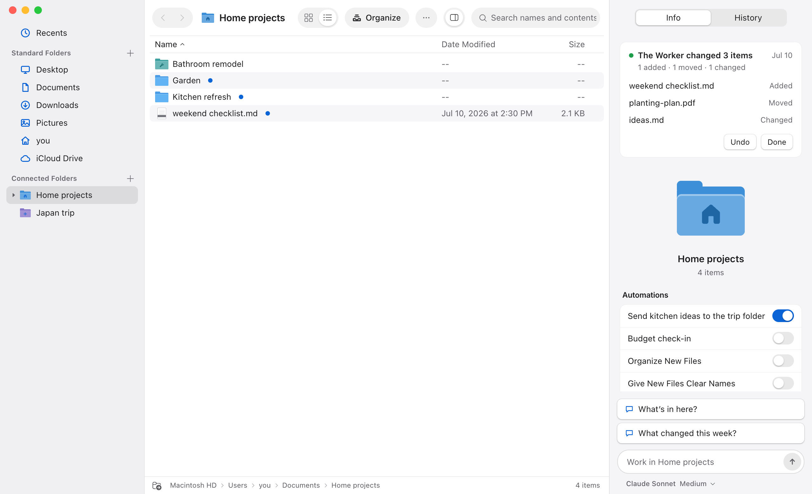

<p align="center">
  <picture>
    <source media="(prefers-color-scheme: dark)" srcset="desktop/assets/brand/amplefile-lockup-dark.svg" />
    
  </picture>
</p>

<p align="center">Workers for the folders you work in.</p>

<p align="center">
  <a href="https://github.com/Mat-Tom-Son/amplefile/releases/latest">Download for Mac</a> ·
  <a href="https://www.amplefile.com/">Website</a> ·
  <a href="docs/README.md">Docs</a> ·
  <a href="CONTRIBUTING.md">Contribute</a>
</p>

<p align="center">
  
</p>

AmpleFile is an open-source Mac app: a file manager for the ordinary folders
you already work in, with an AI **Worker** for each one. It is for people who
keep their work in folders—research, writing, planning, paperwork, code—and
want an assistant that works on the actual files, beside the originals,
instead of copies pasted into a chat.

For example: open a folder of vendor quotes, ask for a comparison, and have the
Worker write a decision brief next to them. Come back tomorrow and pick up the
same conversation.

## Install

1. [Download the latest release](https://github.com/Mat-Tom-Son/amplefile/releases/latest)
   for an Apple-silicon Mac and drag AmpleFile to Applications.
2. Open it. First run connects your AI (sign in with ChatGPT, Claude, or
   OpenRouter, or paste an API key; provider usage may cost money), then asks
   for your first folder. Change the model anytime in **Settings → AI Models**.
3. On the card that appears, choose **Set Up for Me** to have the Worker
   organize the folder and give it a look, or just start a Chat.

Files stay on your computer. Content a Worker uses goes to the model provider
you choose; see [Privacy](PRIVACY.md).

## Run from source

You need Git, **Node 24**, and **npm 11.16 or newer** (check `npm --version`;
some Node 24 releases bundle an older npm).

```sh
git clone https://github.com/Mat-Tom-Son/amplefile.git
cd amplefile
npm ci
npm run local:dev
```

Open **http://localhost:5173** for the app in a browser, or
**http://localhost:5173/?fixture=connected-folder** for a preview with sample
data that needs no model or folder. [Contributing](CONTRIBUTING.md) covers the
native app, tests, and what to do when the toolchain is wrong.

## How it works

- **Connected Folders.** Each Connected Folder is an ordinary folder you chose,
  with its own Worker and Chats. It is never moved or converted; it stays usable
  in Finder and your other tools. Connected Folders can nest, and `@` in a
  message box addresses a Worker.
- **The AmpleFile Agent** lives in the menu bar, above all your Connected
  Folders. Ask it what needs attention, or have it hand work to a Worker; the
  Worker reports back, and asks rather than guesses when it needs something.
  See the [collaboration experience](docs/collaboration-experience.md).
- **Automations** run fixed steps on a schedule or after chosen files change.
  They are deterministic, optional, and can be turned off. See
  [Automations](docs/automations.md).
- **Nothing is lost.** What a Worker or the AmpleFile Agent does happens right
  away and leaves a record you can read in the app. **History** keeps versions
  of your files, and anything History cannot keep waits in
  **Recently Deleted** for 30 days.
- **Tools.** Workers can use a [built-in browser](docs/built-in-browser.md),
  run long commands as [background jobs](docs/background-jobs.md), use
  [collaboration and Git tools](docs/worker-tools.md), and use the
  included Computer Control, Web, Documents, and Service Connections
  tools, managed with any Skills and Extensions you add in
  **Skills & Extensions** ([details](docs/skills-and-extensions.md)).
- **Other agents.** **Settings → Command Line** adds the `amplefile` command so
  Claude Code, Codex, and other shell agents can hand work to your Workers and
  follow it. See [the AmpleFile Agent and CLI](docs/amplefile-agent-and-cli.md).

Built with Electron, React, TypeScript, and the [Pi agent runtime](https://pi.dev).
The [docs map](docs/README.md) covers architecture, product contracts, and
release procedures.

## Help build AmpleFile

AmpleFile is an actively developed independent project, and help building and
maintaining it is welcome: UI polish, reliable tests, clearer onboarding, and
real-world bug reports. [Open an issue](https://github.com/Mat-Tom-Son/amplefile/issues/new/choose)
or start with the [contributing guide](CONTRIBUTING.md).

[MIT License](LICENSE) · [Security](SECURITY.md) · [Privacy](PRIVACY.md) · [Development](docs/development.md)
