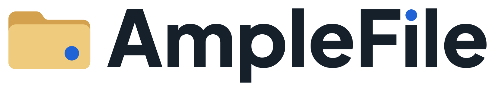

<p align="center">
  <picture>
    <source media="(prefers-color-scheme: dark)" srcset="desktop/assets/brand/amplefile-lockup-dark.svg" />
    
  </picture>
</p>

<p align="center">Workers for the folders you work in.</p>

<p align="center">
  <a href="https://www.amplefile.com/download/macos">Download for Mac</a> ·
  <a href="https://www.amplefile.com/">Website</a> ·
  <a href="CONTRIBUTING.md">Contribute</a> ·
  <a href="docs/README.md">Docs</a>
</p>

AmpleFile is an open-source Mac app that brings your files, AI conversations, and project tools together. Open a folder, tell its Worker what you need, and work on the actual files. Research, writing, planning, code—whatever belongs in that folder.

For example: open a folder of vendor quotes, ask for a comparison, and have the Worker write a decision brief beside the originals. Come back tomorrow and pick up the same conversation.

## Connected Folders and Workers

Each **Connected Folder** has its own **Worker** and conversations. Your files stay ordinary files, accessible in Finder and your existing tools. A Connected Folder is an ordinary folder you choose to work in; it is never converted into a proprietary container.

The **AmpleFile agent** is the agent above your Connected Folders. Ask it what needs attention or have it coordinate work between projects from the Mac menu bar. Hand a piece of work to one Connected Folder's Worker and it reports back here; if it needs something first it asks, and your answer picks the work up where it stopped.

You can register Connected Folders inside another Connected Folder. The sidebar
shows each nested Connected Folder under its parent, and opening one shows it
with its own Worker. Type `@` in a Chat or the AmpleFile agent's message box to
address a Worker.
The local `amplefile connected-folders list --json` projection includes `parentConnectedFolderId`
for a nested Connected Folder; see [the AmpleFile agent and CLI guide](docs/amplefile-agent-and-cli.md).

As a project grows, set up an **Automation** to run fixed steps on a schedule or after selected files change. Automations are deterministic app-run steps, not a second kind of Worker or an open-ended agent scheduler. They are optional; start with a Connected Folder and a conversation.

Workers and the AmpleFile agent can also use AmpleFile's
[built-in browser](docs/built-in-browser.md). They can read and use pages,
inspect screenshots, hover and drag, work inside scrolling panels, attach local
files to file inputs, and find completed downloads. Its sign-ins belong to
AmpleFile's own profile, separate from Chrome.

What a Worker or the AmpleFile agent does happens right away and leaves a record you can read in the app. Nothing it deletes is gone for good: **History** keeps versions of your files, and anything History cannot keep waits in **Recently Deleted** for 30 days. Anything running on a schedule can be turned off afterwards.

Use **Compare** in a file's **Version History** to read saved text beside the current file before restoring. Binary, oversized, uncaptured, and incomplete comparisons explain their limits. The authenticated CLI offers paged `history list`/`versions`, verified `history read --offset-bytes 0` ranges for large saved text, and streaming `search` with `--path` narrowing and `--cursor` continuation; see `amplefile help history` and `amplefile help search`.

## Try it

1. [Download AmpleFile](https://www.amplefile.com/download/macos) for an Apple silicon Mac.
2. Open it. First run connects your AI (sign in with ChatGPT, Claude, or OpenRouter, or paste an API key; provider usage may cost money), optionally sets up Chrome and Computer Control, then asks for your first folder. You can change the model anytime in **Settings → AI Models**.
3. Choose **Set Up for Me** to have the Worker organize the folder and give it a look, or just start a Chat.

Microsoft Foundry chat deployments connect in **Settings → AI Models** using
separate Responses, Chat Completions, and Anthropic connections. Enter the
endpoint, API key, and deployment names for each format you use; all three can
stay connected together. See
[model connections](docs/skills-and-extensions.md) for setup and scope.

Files live on your computer. Content a Worker uses goes to your chosen model provider. See [Privacy](PRIVACY.md) for details.

## Under the hood

Handed-off work is tracked as a durable request: a question
waits for its answer and continues once, and each Worker reports one result to
whoever asked. The request graph and original assignments stay machine-local,
and only results a Worker deliberately releases reach another Connected Folder's Chat.
See the
[collaboration contract](docs/collaboration-contract.md#completion-delivery-and-recovery)
for stop, expiry, and restart behavior, and the
[collaboration experience](docs/collaboration-experience.md) for how progress,
questions, and result files appear in Chats and the AmpleFile agent.

Claude Code, Codex, and other AI agents can use AmpleFile too: **Settings →
Command Line** adds the `amplefile` command to Terminal and adds a short skill
that teaches an agent to hand work to your Workers, follow it, and run
Automations. See [the CLI guide](docs/amplefile-agent-and-cli.md).

Long work runs in the background: a Worker or the AmpleFile agent starts an
export, build, install, or server as a background job, keeps working or ends
its turn, and is brought back to the same Chat once with the result when the
command finishes. History captures what the job changed, its output stays on
this computer, and Stop or quitting ends it. See
[Background jobs](docs/background-jobs.md).

Workers also have structured collaboration tools, asynchronous questions,
interactive terminal input, managed Git working copies, and focused read-only
helpers. Workers and the AmpleFile agent can recover completed tool evidence
and saved findings after compaction with `progress`, including file freshness
checks. See [Worker tools](docs/worker-tools.md) for their lifecycle and limits.

The AmpleFile agent's menu-bar popover has a **Chats** view that reopens saved
conversations and keeps unsent drafts while you switch.

**Skills & Extensions** manages native Pi resources, package updates and
removal, and setup for the included Computer Control, Chrome, Web, Documents,
and Service Connections tools, which use the same Pi formats and tool loop as
Extensions you add. Computer permissions, the Chrome companion (installed from
the [Chrome Web Store](https://chromewebstore.google.com/detail/ophmjbphcjmjcpcdpmfehbldiomkepgk)),
and service credentials are explicit setup; web search
and the document runtime work without them. An ordinary Extension's questions appear in its owning Chat and
end with Stop or the session; a Worker's durable questions keep their own
continuation contract. See [Extensions and computer work](docs/extension-foundation.md)
for supported jobs, dependencies, reviewed patches, and release acceptance.

Developers can inspect upcoming model calls through the local `?dev-context`
diagnostic route. Recording starts off, has no Chat or Settings entry, and
keeps assembled context, provider payloads, and source provenance in bounded
local memory. The [feedback contract](docs/tool-feedback.md) keeps Pi's tool
loop for text, data, and selected images without continuous screen recording.

## Help build AmpleFile

This is an actively developed independent project, and I'd love people to build and maintain it with me. UI polish, reliable tests, clearer onboarding, and real-world bug reports would all help.

[Open an issue](https://github.com/Mat-Tom-Son/amplefile/issues) with something you'd like to improve, or start with the [contributing guide](CONTRIBUTING.md). Small, focused contributions are welcome.

Built with Electron, React, TypeScript, and the [Pi agent runtime](https://pi.dev). To run a clone locally, use Node 24 (`.nvmrc`):

```sh
npm ci
npm run local:dev
```

Open **http://localhost:5173** for the browser development UI. See [Contributing](CONTRIBUTING.md) for native Electron and agent setup.

Check changes with `npm run check` and `npm test`; run `npm run desktop:prepare` for desktop integration changes. The [docs map](docs/README.md) covers architecture, product decisions, and release procedures. [AGENTS.md](AGENTS.md) is the shared contributor contract.

[MIT License](LICENSE) · [Security](SECURITY.md) · [Development](docs/development.md)
