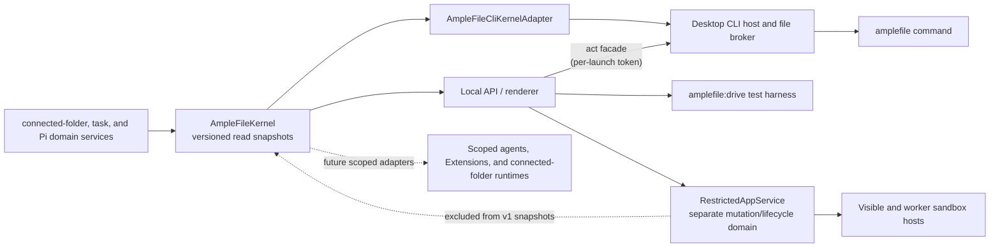

# The AmpleFile agent and CLI

The **AmpleFile agent** is the current product name for the management Worker
above all Connected Folders. This document deliberately keeps *management*, `fold`,
`connected-folder`, and `automation` in technical contracts, commands, paths, schemas, and
code identifiers. In the product, people see **Connected Folders**, **Workers**, and
**Automations**.

> Request lifecycle consolidation: the [collaboration contract](collaboration-contract.md#completion-delivery-and-recovery)
> governs completion across turns. Questions use `chat ask|answer` or `agent
> ask|answer`; an accepted answer remains outstanding until linked. The AmpleFile agent,
> Connected Folder and app owners receive bounded, recorded child-result deliveries.
> App status/stop/usage follow the owned request, and task result reads expose
> its selected envelope. Counts and transport sizes shown in Limits are fixed
> in this build; the continuation switch is configurable.


The desktop and local browser renderer share one authenticated
`POST /api/events` SSE connection per renderer across Chat, AmpleFile agent Chat,
Connected Folder file-monitoring, and control subscriptions. The request carries at most
128 uniquely identified subscriptions to exact supported local stream paths,
within a 64 KiB body. Each Chat consumer keeps its own replay cursor, including
two consumers of the same Chat. Changing subscriptions aborts and drains the
old connection before its replacement opens; late frames cannot reach the new
subscription generation. This keeps start, answer, and Stop requests out of
Chromium's HTTP/1.1 connection limit even with many mounted background Chats.

The underlying direct GET streams remain compatible. The closed `reset`,
`apps`, `connected-folders`, `assistant`, and `activity` control hints contain no content or authority;
renderers re-read the relevant service after a hint and reset on reconnect.
`GET /api/connected-folders/activity` returns only the Connected Folder and Chat ids of running
Worker turns, including those without a mounted Chat tab. The renderer uses
that projection for activity marks and records unseen replies locally.
`GET /api/connected-folders/outline` reads registered ids, names, and roots without
rewriting portable manifests; local composers use it to address Workers.
File watchers have no replay log and refresh Files after every ready signal,
covering changes during reconnection. Chat replay retains its existing event
log, transient Extension interaction snapshots, and proposal filtering.
A removed or failed subscription closes independently; removing a Connected Folder also
closes its file watchers. Parent disconnect disposes every child watcher and
timer. The host caps physical connections, sends heartbeats, and bounds the
aggregate queued output to 512 KiB. Origin and renderer-session checks still
apply before admission. This is explicit renderer transport, not a model or
workflow event bus, a new act verb, or arbitrary HTTP forwarding.
Successful agent configuration mutations emit `assistant` after idle-client
invalidation, whether initiated by Settings or the CLI. Empty Chat composers
re-read the saved default; existing Pi sessions keep their own model. Settings
refreshes clean forms while preserving unsaved edits. Connected Folder hints first reconcile
the registry, then refresh catalogs only for surviving registrations; obsolete
requests cannot restore a removed Connected Folder or report a late error from its surface.

App act commands accepting `--app` resolve a unique manifest id or an exact
`featureInstallationId`. Ambiguous names refuse and list exact choices. The
resolved installation and digest travel through the existing domain controls,
including grant and automation execution; remove/reinstall cannot redirect
an admitted operation to identical replacement bytes. This is an act-lane
selector extension, not a protocol-v1 inventory or authority change.

AmpleFile now has a small AmpleFile agent layer over its existing product model. It gives the renderer, command line, test harnesses, and future agent-facing adapters one semantic view of Connected Folders, running work, and Pi capabilities without creating another data store or agent framework.

This is infrastructure, not another navigation item. **AmpleFile**, **Connected Folder**, **Files**, **Chats**, **History**, and **Skills & Extensions** remain the user-facing nouns. The AmpleFile agent layer makes their underlying state inspectable in a consistent, versioned form.

The development extension UI adapter treats the AmpleFile agent as its own valid scope.
`GET /api/amplefile-agent/conversations/:id/extension-ui` and its Connected Folder equivalent
return current live Pi questions; `POST .../extension-ui/:requestId` validates
one response for that exact Chat. Chat SSE sends `extension_ui_snapshot` on
connection and change without putting prompts or answers in its replay log.
These session-local callbacks are
not durable request questions and never dispatch a continuation turn; see
[Skills & Extensions](skills-and-extensions.md#live-extension-questions).

## Local context diagnostics

The development `GET /api/model-context` and `GET /api/model-context/:id`
routes read retained local diagnostics; optional `connectedFolderId` and `conversationId`
filters pin the exact owner. A conversation filter requires a Connected Folder filter.
`POST /api/model-context` accepts either `{ enabled: boolean }` or
`{ clear: true }`. These use the existing local renderer authentication, have
no CLI operation, never create a client or Pi session, and
cannot influence execution. All-request access is a developer diagnostic view,
opened in the installed app through an explicit launch argument and its own
diagnostics-only sandboxed window, never an ordinary Settings entry.
Disabling, clearing, expiry and shutdown discard the memory-only records.
See [model context inspection](tool-feedback.md#inspect-model-context).

## Why it exists

The desktop UI already knows how to work with Connected Folders and Pi, but a higher-level agent, an Extension, a script, or a future Connected Folder runtime also needs answers to basic questions:

- Which Connected Folder applies to this actor and working directory?
- Which Connected Folders are registered?
- Which agent turns or Chat compactions are still running?
- Which Skills, Extensions, tools, packages, prompts, themes, and commands are available in this Connected Folder, and what are their scope, source, trust, and load states?

Those answers should not be reimplemented by every consumer. `AmpleFileKernel` is the shared in-process read authority that produces them.



Domain services still own writes. The kernel does not bypass folder grants, registered Connected Folder authorization, capability-mutation locks, History behavior, or any other mutation policy.

The desktop's early-created Check service shares the interactive API's bounded,
serialized fold-model reviewer through an in-process callback. This transport
is resolved only for an authorized Check run; it adds no read-protocol, HTTP,
or act-lane verb.

The dotted restricted-app edge is a boundary, not a data flow into the kernel. Connected Folder apps have their own reviewed package, grant, encrypted connection, storage, named-automation, notification, and sandbox-host state. Protocol v1 and `amplefile.capabilities` intentionally do not list or mutate that state. The machine-wide automation scheduler is an in-process execution coordinator for that domain, not a management-protocol mutation surface. Future app inventory belongs in a deliberately versioned kernel snapshot only after its content and authorization contract are designed.

## Kernel contract

`src/local/amplefile-kernel.ts` defines `ampleFileKernelSnapshotVersion` and a normalized actor context:

```ts
interface AmpleFileActor {
  kind: "human" | "assistant" | "cli" | "renderer" | "extension" | "app" | "system";
  cwd?: string;
  connectedFolderId?: string;
  conversationId?: string;
}
```

Connected Folder resolution is deterministic:

1. An explicit `connectedFolderId` wins.
2. Otherwise, the most-specific registered Connected Folder whose root contains `cwd` wins. This matters when registered Connected Folder roots are nested.
3. Otherwise, the result has no Connected Folder context.

The current snapshot version is `1` and exposes four read models:

| Snapshot | What it contains |
|---|---|
| `amplefile.context` | Normalized actor, resolution method, and resolved Connected Folder or `null`. |
| `amplefile.connected-folders` | Registered Connected Folder identities, roots, ownership/location metadata, and timestamps. |
| `amplefile.tasks` | Running `assistant_turn` and `compaction` records, optionally scoped to one Connected Folder. |
| `amplefile.capabilities` | Pi's authoritative capability catalog plus packages, project authorization, mutation eligibility, provenance, and diagnostics for one Connected Folder. |

The local API and the desktop CLI share one kernel instance. Agent turns and Chat compactions register a task when work is accepted and finish it in success and failure cleanup paths. An idle Chat whose context has passed 80% of the point where Pi would compact it mid-turn is summarized in the background about ten seconds after its reply, as a `compaction` task with a `system` actor; it runs only when Pi's automatic compaction is on, never refuses the person, and is cancelled by a new message, a manual compaction, Make a Copy, deletion, or quit, after which Pi still compacts mid-turn if it must (2026-10-27). Pi's own mid-turn compaction stays inside its turn's task. Capability mutations remain blocked while affected work is active, so a catalog reload cannot silently terminate a background turn.

Capability snapshots are projections of Pi's native catalog. They do not create a second full-trust registry, activate inactive tools, bypass the Connected Folder registry, or install anything.

Trusted Chat streams also carry throttled `runtime` snapshots during native Pi
activity. Streaming text uses Pi's own token estimator until finalized usage is
available; reconnect refreshes the current runtime. A successful compaction
appends a presentation-only `system` message with kind `context_compaction`, then
publishes `context_compacted` with that saved message. Manual, automatic and
background compactions share this path. The notice contains no summary text,
does not become a model message or result, and remains visible in desktop
and menu-bar transcripts. Failure and cancellation leave no success
notice. The content-free CLI snapshots and task lifecycle are unchanged.

This contract belongs only to AmpleFile's new profile and `.amplefile/` data. The kernel and its adapters never parse or project a legacy Workspace registry or `.workspace/` manifest. Registering a folder that contains preserved `.workspace/` data creates a new AmpleFile Connected Folder identity instead of adopting the old one.

## AmpleFile CLI

The Windows installer places `amplefile.cmd`, an extensionless `amplefile` shim, and the private `amplefile-cli.ps1` helper in `<install>\bin`, then adds that directory to the current user's `PATH`. The Mac bundle places the extensionless shim and `amplefile-cli.jxa.js` under `AmpleFile.app/Contents/bin`; AmpleFile adds that directory to child-process `PATH` for Pi shell tools without editing a person's Terminal profile.

### Other AI agents (Settings → Command Line)

Claude Code, Codex, or any agent that runs shell commands can drive AmpleFile through this command (owner request, 2026-11-07). **Settings → Command Line**, also offered in first run, has two parts, and nothing changes until the person clicks:

- **Add to Terminal** writes one line, the app's own `Contents/bin`, to `/etc/paths.d/<command>`, which every login shell reads, the way Postgres.app does it. macOS asks for the person's password once. The launcher finds the app from its own folder, so the PATH names that folder rather than a symlink. It is offered only by an installed Mac app running from its own place (not a translocated download copy); the row says when another copy's entry is there, and **Remove** deletes the line.
- **AI Agents** writes the skill to `~/.claude/skills/<command>/SKILL.md` (Claude Code) or `~/.codex/skills/<command>/SKILL.md` (Codex), shows when an app update changed it, and removes only a skill whose front matter names this one. **Copy Skill** hands it to any other agent. `amplefile skill` prints the same file.

The skill (`src/shared/outside-agent-skill.ts`) is short on purpose: the rules (`--json`, an explicit `--connected-folder`, receipts over raw edits, no secrets, no polling), how to look around, handing work to a Worker and waiting for its result, asking the AmpleFile agent to work across Connected Folders, files and undo, and Automations, with `amplefile help <command>` for the rest. Its product name, command, and folder all come from `src/shared/product-identity.json`, and `tests/outside-agent-skill.test.ts` checks every command it cites against this help.

```powershell
amplefile context --json
amplefile connected-folders list
amplefile tasks list --connected-folder "Everywhere connected-folder"
amplefile capabilities list --connected-folder "Everywhere connected-folder" --json
amplefile version
amplefile help capabilities
```

`connected-folders list --json` adds `parentConnectedFolderId` to a Connected Folder registered inside another Connected Folder's folder (2026-10-01); a top-level Connected Folder's projection is unchanged.

`--connected-folder <id-or-exact-name>` selects a Connected Folder explicitly. Without it, Connected Folder–aware read commands resolve the terminal's current working directory. Duplicate exact names are rejected as ambiguous; use the stable Connected Folder id in automation. `--json` emits the stable protocol projection and is the preferred interface for scripts, Codex, Claude Code, and other shell-capable harnesses.

The read commands stay content-free: Connected Folder names and paths, task metadata, and capability metadata — no file contents, conversation text, credentials, or provider tokens.

The same command also carries the **act lane** — the separately versioned, per-launch-authenticated surface through which a shell-capable agent can operate the product while the AmpleFile app is running:

```powershell
amplefile chat create --connected-folder "Home"
amplefile chat send --connected-folder "Home" --new --message "File the material I dropped."
amplefile chat send --connected-folder "Home" --conversation <id> --message-file notes.md
amplefile chat status --connected-folder "Home" --task <task-id> --json
amplefile chat wait --connected-folder "Home" --task <task-id> --timeout 900 --json
amplefile chat result --connected-folder "Home" --conversation <id> --messages 5 --json
amplefile chat abort --connected-folder "Home" --conversation <id>
amplefile chats list --connected-folder "Home" --json
amplefile connected-folders create --name "Vendor Audits"
amplefile connected-folders register --path /Users/me/Projects/existing-folder
amplefile files add --connected-folder "Vendor Audits" --from ./report.pdf --to "Inbox" --json
amplefile agent send --message "File everything I dropped into the right connected-folders."
amplefile agent send --message "Put this where it belongs and start a review." --attach ./report.pdf --attach https://example.com/owner/project
amplefile agent wait --task <task-id> --json
amplefile agent status --task <task-id> --json
amplefile agent stop --task <task-id> --json
amplefile chat report --connected-folder "Home" --task <own-task-id> --summary "Filed three invoices." --file "Invoices/2026-09.pdf" --json
amplefile chat ask --connected-folder "Home" --task <own-task-id> --question "Which quarter?" --to parent --json
amplefile chat answer --connected-folder "Home" --question <question-id> --answer "Q3." --json
amplefile chat handoff --connected-folder "Home" --task <own-task-id> --to-connected-folder "Vendor Audits" --message "Review the filed invoices." --file "Invoices/2026-09.pdf" --json
amplefile requests list --json
amplefile requests show --request <request-id> --json
amplefile jobs start --connected-folder "Home" --task <own-task-id> --command "npm run build" --name "Build" --json
amplefile jobs output --connected-folder "Home" --job <job-id> --until "ready|listening" --wait 120 --json
amplefile jobs stop --connected-folder "Home" --job <job-id> --json
amplefile tools disable --path <resource-path> --kind extensions --scope everywhere --json
amplefile tools enable --path <resource-path> --kind extensions --scope connected-folder --connected-folder "Home" --json
amplefile recently-deleted list --json
amplefile recently-deleted restore --entry <recently-deleted-id> --json
```

`tools enable|disable` uses Pi's resource filters for `extensions`, `skills`,
`prompts` and `themes`. The desktop and CLI share the prepared
`capability.resource.enabled` operation: resolve the exact catalog resource
and scope, pin resource bytes and settings, journal, recheck under the existing
capability fence, then write one native filter. Included resources use this
same path. Unrelated package defaults and filters are preserved; active work
refuses the mutation rather than being interrupted. Native single-file package
sources do not support filtering and return that limitation. Connection
readiness is separate from enablement: included MCP/browser/OS secret setup
stays local and has no act operation. See
[Extensions and computer work](extension-foundation.md).

The four collaboration verbs ([the collaboration contract](collaboration-contract.md),
F27) are Connected Folder–scoped, receipted, and host-delivered: `chat report` attaches
one result envelope to the caller's own running turn, `chat ask` records a
question and puts that task's request in `waiting` without suspending the
turn, `chat answer` records exactly one answer and starts exactly one linked
continuation turn in the same Chat (the turn store dedups it under
`answer-<question-id>`, so a replayed answer returns the same turn), and
`chat handoff` copies the named files into the destination through the same
additive, restore-pointed path as `files add` and then starts a new Chat
there as a child of the caller's request. `requests list|show` are
management-scope reads of the request graph, and `chat wait`/`agent wait`
settle on a terminal turn **or** on a task that is waiting, saying which; the
status documents carry `waiting` and the request ref beside the turn state.
The records, refusals, waiting semantics, continuation rule, and limits are
specified under
[Durable requests, questions, and continuation](#durable-requests-questions-and-continuation).

`amplefile jobs …` drives **background jobs** ([Background jobs](background-jobs.md),
F31–F33) with the same service and records as the `job_start`, `job_output`,
and `job_stop` tools every Worker and the AmpleFile agent carry. `jobs start`
runs a shell command for the caller's own running turn (`--task`, checked like
`chat report`) in its own process group, journaled before it spawns and never
re-run; the job joins that turn's request, which reads `working` while it
runs. Every verb names the job's Connected Folder, so a Worker reaches only its own
Connected Folder's jobs; the AmpleFile agent's own jobs are reached through its
tools and listed by `requests show`. `jobs output` reads the end of the
output or a page from `--offset`, can `--wait` for the end or `--until` a line
matches, and with `--task` naming a running turn in the job's own Chat counts
as the job's delivery. When a job ends, the host captures History for its
Connected Folder and brings the exit status, that coverage, and the end of the
output back to its Chat once — through a read, the next turn's context, or
one follow-up turn on the F28 path. Stop on the request and quitting AmpleFile
stop jobs; a restart records a running job `interrupted` and wakes nothing.
Output lives under the state root's `jobs/` directory and follows the request
retention window. Deletion, registration removal, and whole–Connected Folder
History restore wait for running jobs; Skills & Extensions changes do not.

There is no `pages` family: pages (`page.json` folders run in a page tab),
`pages validate`, `pages publish|unpublish|list`, and the `page.publish`
prepared act were removed on 2026-11-07.

`amplefile recently-deleted …` reads and restores **Recently deleted**, the machine-local
store under the state root that holds what a delete could not leave to History:
files and folders the safety restore point could not keep a copy of, deleted
managed Connected Folders, removed imported Skills, app data that was cleared or
purged, deleted App Studio Releases, and the App Studio history a removed
Connected Folder takes with it
([Receipts, not gates](receipts-not-gates.md), F20). Like `automations` it
sits above Connected Folders, so neither verb takes `--connected-folder`; each item names
the Connected Folder it came from. `recently-deleted list` is content-free — ids, kinds, paths,
sizes, and dates. `recently-deleted restore` puts one item back where it came from,
renaming it when something else took the name; a Skill (kind `skill`, with its
`scope`) goes back to the same scope and path and loads with the next turn, and
is refused while a Skill of the same name is installed there; an Everywhere
Skill names the AmpleFile agent's scope id as its Connected Folder; a Release goes back into its App
Project, re-verified, unless that version has been prepared again; App Studio
history goes back once its Connected Folder is registered again, re-verified, with its
previews' data; and app data whose app is gone
is saved as a file with `--to <absolute-path>`. `connected-folders delete` and
`connected-folders unregister` name the App Studio item they kept as
`appStudioRecentlyDeleted`. Nothing empties the store: the
retention window in Settings → Recently deleted does, and a tree
holding legacy `.workspace/` records is never erased.

Connected Folder Chat deletion moves its portable transcript into Recently deleted and
records the Connected Folder, Chat, and recovery-entry identities in its receipt.
Restoration preserves the transcript filename, refuses an occupied identity,
and requires the original Connected Folder to remain registered. Creation with an
explicit Chat id, renderer and CLI title/lifecycle changes, deletion, and
restoration share the Chat mutation fence through their final filesystem
write, so overlapping operations cannot recreate or rename a deleted Chat.

`amplefile agent …` talks to the **AmpleFile agent**, the one conversation above all Connected Folders. It reuses the same acceptance path, Pi runtime, kernel task records, and task-scoped outcome semantics as Connected Folder Chats under the dedicated scope id `amplefile-agent` instead of a Connected Folder id. Its transcript lives in machine-local application state under the app profile's `management/` root — it describes this machine's registry, so it is deliberately not portable Connected Folder data. Its Pi session loads Everywhere Skills and Extensions plus exactly two app-materialized project resources — an `AGENTS.md` context file and the `manage-connected-folders` Skill, rewritten on every start — and gets no user Connected Folder's `.pi` configuration, no restricted-app bridges, and no History checkpoints (History is a Connected Folder concept).

Those two app-owned resources are required, not an optional enhancement. If AmpleFile cannot materialize them safely, ordinary Connected Folders and the desktop may still start, but management commands fail closed until the AmpleFile agent folder can be prepared; AmpleFile never runs this full-trust scope as an unidentified, uninstructed agent.

Be precise about its authority: the AmpleFile agent is a **full-trust agent, taught rather than caged**. Like every AmpleFile agent it keeps Pi's ordinary read/bash/edit/write tools, which accept absolute paths anywhere this user can reach. The materialized instructions teach it to prefer the `amplefile` read and act commands for anything that touches Connected Folders — those carry the trust grants, restore points, receipts, and conflict rules — but that preference is instruction, not an enforced authority boundary. An enforced CLI-only management agent would be a different, deliberate design (per-session tool restriction) that this personal, local product has not adopted.

Without `--conversation`, manage commands target the most recent active AmpleFile agent, `agent send` creates it on first use, and `--new` deliberately allows additional threads while the default stays a single conversation; AmpleFile agent turns appear in `amplefile tasks list` under the AmpleFile agent scope id. The menu-bar popover exposes the same choice as **New chat**: the view becomes a clean slate immediately, the first send creates the new machine-local transcript, and the previous transcript remains saved rather than being cleared or rewritten. A person may rename or delete an idle AmpleFile agent Chat there; deletion moves its exact transcript into **Recently deleted** under its Chat title and restoration preserves that Chat identity. Running, compacting, or unsettled Chats refuse deletion.

### Management attachments, request lineage, and the popover surface

`agent send --attach <path-or-link>` (repeatable, at most 16) attaches **references, not copies**: absolute or cwd-relative file and folder paths, or http(s) links. A Connected Folder Chat stages dropped material inside the Connected Folder because Connected Folder transcripts are portable; the AmpleFile agent transcript is deliberately machine-local, so its attachments carry absolute paths, missing sources are refused at send time, and the only copy in the flow stays the restore-pointed `files add` into a destination Connected Folder. Readable files inline into the turn within the shared context budget; folders, binaries, and oversized files stay honest path-only references; links arrive as a typed list, never as fake files. The typed references persist on the management user message, and `--attach` rides in ordinary act argv — the act protocol's envelope and payload shapes are unchanged.

Every accepted AmpleFile agent turn is a **request**. Its hidden turn context supplies that request's task id and, like every Worker turn's, the host's local time, time zone, and platform (docs/collaboration-contract.md, 2026-10-18 amendment), and the app-owned instructions require `--parent-task <id>` on `chat.send`, `files.add`, `connected-folders.create`, and `connected-folders.register`. The act host validates that explicit parent while it is active before journaling or running the mutation; attributed actions become the request's action trail, delegated turns become its children, and act receipts gain the same `parentTaskId`. An unrelated same-user CLI action is therefore never credited merely because one AmpleFile agent turn happens to be running, and concurrent AmpleFile agent turns remain unambiguous. This is lineage, not a new caller-authentication boundary: the act token still has the documented same-user posture. Every accepted turn — management, Connected Folder, CLI, automation hop, or app-requested — belongs to one **durable request record** under the state root's `requests/` directory (docs/collaboration-contract.md, F25): an AmpleFile agent turn creates a root, `chat send --parent-task` creates a child under it, a Connected Folder turn with no parent is its own root, and a person's reply to a request waiting on their answer joins that request as a further turn rather than opening a second record. The record carries the assignment text, attachment references, the attributed action trail, child request ids, questions and results by id, rolled-up usage, and a state from the vocabulary `working`, `waiting`, `handed_off`, `done`, `partial`, `failed`, `stopped`, `expired`. Records survive restart: after the turn journal repairs itself at startup, every request still believed live is reconciled against it — settled, never re-dispatched — and stamped as recovered so nothing continues it. Settled request graphs are kept for 30 days. Transcripts and act receipts remain the long-lived content records, while the bounded machine-local turn journal preserves acceptance identity, stream checkpoints, and recent terminal outcomes.

`agent status --task` therefore reports a `request` object alongside the turn: per-attachment **dispositions** computed from recorded actions (`placed`, `registered`, or honestly `unrecorded`), recorded actions with restore-point ids, child turns with their own task states, the reply, and a **phase** — `working`, `needs_you` (an open question, or a reply whose final line asks one), `handed_off` (the AmpleFile agent turn finished but a delegated Connected Folder turn still runs), `done`, `failed`, or `stopped`. The durable record's own `state` travels beside the phase (`partial` reads as `done` there and `expired` as `stopped`), with the request id, root id, kind, deadline, and bounded question and result references. Done requires both the AmpleFile agent turn and every child to succeed; a failed or lost child fails the request, and an aborted child or accepted request-level stop stays stopped. A popover reply to `needs_you` joins the same request as a further turn — one record, one story — carrying the prior attachments and action trail without replaying those attachments into model context, and it is recorded as the answer to any open question that was waiting on the person. `agent stop --task` aborts the AmpleFile agent turn and every turn still running anywhere under that request, withdraws its open questions, and names each turn it touched.

The same request model backs the desktop's **menu-bar popover** (macOS menu-bar item; the Windows tray gains the same "AmpleFile agent" entry), which talks to `/api/amplefile-agent/*` local-API routes — send with attachments, summary, request status, request stop, transcript, per-conversation runtime and thinking-level changes, and the event stream — through the same acceptance path, conflict rules, and kernel task records as every other surface. The popover is deliberately a window, not a tab, so the Connected Folder–bound tab contract is untouched. Its transcript stays visible as a conventional compact chat: person messages are colored bubbles aligned right, agent replies are unboxed and aligned left, and redundant speaker labels and divider lines are absent. It follows streamed text while pinned near the bottom but respects deliberate scrollback. The header shows the current chat title, with separate **Previous** and **New chat** actions. The per-conversation stream renders replay-safe `turn_snapshot`, incremental `assistant_delta`, and final `assistant_message` text in place; when the request settles, the persisted transcript replaces that transient projection. The composer's model label uses one fixed bridge to show the main window's **Settings → AI Models** scoped to **AmpleFile agent**; the adjacent text-only reasoning selector is hydrated from the AmpleFile agent's selected model before the first send, saves Pi's default for a future session, and writes the live Pi session once the conversation has one. The aligned action becomes **Stop** while the request is active, using the existing request-scoped stop route, while the text area remains available for drafting; one compact live line carries the current activity without displacing the transcript. Dropping onto the macOS menu-bar icon stages bounded references, while dragging over the popover temporarily turns the whole surface into the drop target; neither sends anything, and send is always an explicit act. Its sandboxed renderer has a dedicated preload exposing only the local API session, dropped-file path resolution, hide/show-main, open-AI-Models-settings (`openAiModelsSettings`), and window-material actions — it does not inherit the main renderer's folder, restricted-app, update, general settings, or shell bridges.

The AmpleFile agent has one machine-local provider/model preference distinct from every Connected Folder preference. Settings → AI Models labels that scope **AmpleFile agent**; the same choice governs this one AmpleFile agent in the menu-bar/tray popover. Each registered Connected Folder may additionally keep bounded machine-local **Worker instructions**, keyed by its portable identity and appended to subsequent Pi turns without changing portable `.amplefile/` or `.pi/` content. Saving them never waits on or interrupts work: idle Chats pick them up at once, and a Chat that is mid-turn or compacting, including the Worker that saved them (as Set up for me does), picks them up as soon as that work ends. Provider credentials remain machine-wide Pi AuthStorage records rather than being duplicated per scope.

### Durable requests, questions, and continuation

[The collaboration contract](collaboration-contract.md) (F25–F29) makes the
request an owned record rather than a projection. Every accepted turn —
management, Connected Folder, CLI, automation hop, or app-requested — joins one. A
AmpleFile agent turn creates a root; `chat send --parent-task` creates a child
under that root; a Connected Folder turn with no parent is its own root; a person's reply
to a request that is waiting on their answer joins the existing record. Records
live under the state root's `requests/` directory, survive restart, and are
never replayed.

A **request** carries its id, kind (`management`, `connected-folder`, `app`, `automation`,
`cli`), root id, parent task id, owner scope (management, or a Connected Folder id plus
conversation id), app installation where one applies, initiating surface,
created-at, state, its turns, child request ids, question ids, results,
rolled-up usage, and a nullable deadline retained for compatibility. New
requests have no deadline. Its state comes from one vocabulary:
`working`, `waiting`, `handed_off`, `done`, `partial`, `failed`, `stopped`,
`expired`. A **question** carries its id, request id, task id, respondent
(`person` or `parent`), text, optional suggested choices (`--option`), asked-at, state (`open`, `answered`, `expired`,
`cancelled`), the answer and answered-at, and the continuation task id. A
**result** is the F29 envelope — `summary`, optional `data`, optional `files`
as Connected Folder–relative paths with a fingerprint and size, and an `outcome` of
`succeeded`, `partial`, or `failed` — plus its task id, recorded-at, and
receipt id.

`requests list` and `requests show --request <id>` are management-scope act
reads of that graph. Like `recently-deleted` and `automations` they sit above
Connected Folders and refuse `--connected-folder`; each record names the Connected Folder it belongs to.

The four collaboration verbs are refusals, not gates. A `--task` must name the
caller's own turn. `chat ask --to parent` on a root with no parent is
delivered to the person, and `--to person` is the default; the asking turn
ends rather than suspending, and its request reads `waiting`. `chat answer`
delivers exactly one answer and starts exactly one linked continuation turn in
the same Chat; a second answer, an expired question, a stopped request, an
answer from a Connected Folder that does not own the question, and a Chat that is busy
are each refused by name. `chat handoff` copies the named files through the
same additive, restore-pointed path as `files add`, starts the destination
Chat through the ordinary acceptance path, and links it as a child of the
caller's root so its report flows back there. Delivery is host-side
throughout: no AmpleFile agent model turn is needed to move a report, an answer, or a
handoff.

Waiting is a host state (F28). `chat wait` and `agent wait` settle when the
followed turn reaches a terminal state **or** when its task is waiting on an
answer, and say which; a waiting settle exits 0 and prints the status document
with its `waiting` field, because waiting is not a failure. A parent turn
never blocks on a child that is waiting for input: it finishes and reports the
request as `waiting`. When every child of an owning request has
settled when the owning Chat is idle and selected child results have not been delivered, the host composes one deterministic
follow-up turn in that conversation — a `system`-actor turn joined to the root,
naming each settled child, its outcome, the files it chose, and any question
still open beneath it. Delivered child turns are recorded so a result is not
delivered twice. A child result the parent's still-running turn reads with
`chat result` or `agent result` (the last step of `chat wait`) counts as
delivered too, so the follow-up never repeats it. There is no continuation-count quota. Continuations never
follow a root Stop, an expired legacy request, a configured spending-cap
failure, or a restart, and a person can turn them off in Settings → Automations
→ Limits. Compaction cleanup reevaluates deliveries deferred by that Chat,
including when compaction fails. Synthesis uses the latest child turn's
selected report and files, or its failure/no-report status; older successes
remain historical, and partial or failed graph outcomes take precedence.

File deletion and Connected Folder removal use the same desktop/CLI reservation against
active turns, compaction, Checks, app jobs with file access, and automation file
work. Unfinished requests, waiting questions, and accepted continuations also refuse deletion;
after Stop, accepted turns must drain first. Managed parent deletion requires
removing nested registrations first. A refused delete changes no content and
creates no safety checkpoint. See [the recovery amendment](receipts-not-gates.md#trash)
for interrupted folder and History moves.

Only the assignment text, the answer text, released report summaries, and
copied files ever enter a Connected Folder Chat. The request graph itself, other Connected Folders'
results, and the AmpleFile agent's transcript stay above Connected Folders.

Requests have no built-in lifetime, child-count, delegation-depth, or
continuation-count quota. One Chat runs one turn or compaction at a time;
different Chats and Connected Folders, including AmpleFile agent Chats, can run concurrently.
Delegated children have no separate slot limit or waiting queue.

Settings → Automations → Limits (`src/shared/amplefile-limits.ts`) shows the actual
request transport bounds, optional spending budget, and retention:

| Limit | Default | On hit |
|---|---|---|
| Provider budget per root | unlimited (a host may set a cap) | request `failed`, names the cap |
| Question text | 4 MiB | the write is refused before it is recorded |
| Answer text | 4 MiB | the write is refused before it is recorded |
| Result summary | 4 MiB | the write is refused before it is recorded |
| Result data | 16 MiB | the write is refused before it is recorded |

Envelope bounds travel with the same machinery: a summary of at most 4 MiB,
structured details of at most 16 MiB validated against the declared schema
when there is one, and question and answer text of at most 4 MiB each. Long
text rides `--summary-file`, `--question-file`, and `--answer-file`. Named
result files have no separate count quota; the containing transport envelope
still has its byte bound. Settled request graphs are kept for 30 days.

### Work presentation for trusted surfaces

`src/shared/request-presentation.ts` defines the version-1 work view. It projects
one request and its linked descendants into labels, available actions, exact
person questions, and selected results with Connected Folder–owned file references. It
contains no sibling transcripts or general request-graph access. Questions are
shown four at a time, with the remaining count; answering reveals the next ones.

The authenticated local API reads it through
`GET /api/connected-folders/:connectedFolderId/conversations/:conversationId/work`,
`GET /api/amplefile-agent/conversations/:conversationId/work`, and
`GET /api/tasks/:taskId/work`. The original task id keeps Apps pinned to their own
request even if the Chat later starts unrelated work. Journaled
`POST /api/requests/:requestId/answer|stop|continue` uses the shared answer, Stop,
and turn-admission paths. Answers carry `questionId` and `answer`; explicit
continuations carry a stable `deliveryId`. A lost-response retry acknowledges
the accepted answer or turn rather than dispatching another one. A continuation
carries the selected child reports and records their delivery before prompting.

See [Collaboration experience](collaboration-experience.md) for rendering,
recovery, keyboard, and privacy behavior. These endpoints are for trusted
surfaces; restricted app bridges receive no new access.

### No remote browser surface

Web Access was removed from the desktop on 2026-11-07. There is no address
enrollment, browser pairing, browser grant, relay client, remote management
facade, remote file preview, remote upload staging, or browser-requested app
action. The hosted bridge stayed with the work-fold repository; the desktop
never connects to it. The browser app views and file previews contracts,
archived in the work-fold repository, record the earlier design.

### Act command behavior

connected-folder-targeted act commands never resolve a Connected Folder from the working directory — every write names its Connected Folder explicitly. `recently-deleted list --json` and `recently-deleted restore --entry <id>` are Connected Folder–free act verbs over the machine-local trash; `apps list --connected-folder <id> --json` and `apps invoke --connected-folder <id> --app <id> --tool <name> --input <json>` let the AmpleFile agent see and call an installed app's declared tools with lineage and receipts. `connected-folders worker show` is a content-bearing act read that returns the current default, only already-connected model choices, and instruction text; `connected-folders worker model` saves the default for new Chats, while `connected-folders worker instructions` changes subsequent turns. Both setters reserve the existing Connected Folder–scoped agent mutation fence across validation, write, and client invalidation, and their receipts contain model identifiers or an instruction character count, never instruction text. Provider credentials and connection setup have no act verb. `chat send` accepts a CLI-initiated agent turn through the exact same acceptance path as the renderer (conflict checks, stable request identity, durable acceptance before transcript append, kernel task record with a `cli` actor, portable transcript persistence, pre/post-turn History checkpoints) and returns a task id. The act-envelope request id is the turn's idempotency key, so an uncertain delivery cannot create a second agent run. Terminal failures and explicit stops append a typed, sanitized agent result before the task settles, including setup failures that occur before a provider can answer; that same durable rule covers the machine-local AmpleFile agent transcript and menu-bar popover, while raw provider diagnostics stay host-side. That task id is how a caller follows exactly its own turn: AmpleFile keeps recent terminal outcomes (`succeeded`, `failed`, or `aborted`, with the persisted response message id or failure message) in a bounded machine-local journal across app restarts. `chat status --task`/`chat result --task` read it, and `chat wait --task` is a shim-side poll that finishes with that turn's own result — a failed or aborted turn exits non-zero instead of presenting an older transcript message as success (wait timeout exit code 7). On startup, an accepted turn that reached its transcript but never settled is recorded as interrupted and is not automatically rerun, because completed tools may already have changed something. Quitting AmpleFile mid-turn records the turn the same way (interrupted, reported as failed), never as a Stop the person asked for. The Chat's last interrupted reply offers **Continue**, which sends the ordinary visible message "Continue where you left off." as a new turn, without the files staged for the person's draft; nothing is replayed. A tool call that never recorded a result reaches the model as an honest error saying it may have partly happened and its effects should be checked, instead of Pi's bare "No result provided" (2026-10-27). `chat status|result --conversation` remain the transcript-scoped views. `files add` copies outside material in with a targeted restore point that succeeds or fails together with the placement, and `connected-folders create`/`connected-folders register` grant the same registered Connected Folder runtime authorization as the desktop actions. Content-bearing chat and agent-preference reads (`chat status|result`, `chats list`, `connected-folders worker show`) belong to the act lane too, so the read lane keeps its content-free property. When the interactive app is not running, act commands fail fast with "Open AmpleFile…" and exit code 6.

Optional Checks reuse this split instead of creating another management plane. `checks status` is the only read-lane Check command and emits aggregate counts/state only. Its experimental summary distinguishes enabled Checks that have `neverRun` from previously computed results whose inputs are `stale`; either keeps the Connected Folder–level state stale until a requested run establishes current evidence. `checks enable|disable|run|task|result|abort|problems|decide` use the act lane, require an explicit Connected Folder, and receive the same journal-first at-most-once receipts. `checks wait` is a shim-side task poll like Chat wait. Portable `.amplefile/checks/*.json` declarations are inert and registration never enables them; authority is an exact-digest machine record. Every run starts an internal kernel `check_run` task and participates in capability-mutation fencing, but the experimental task kind is deliberately filtered from stable `amplefile tasks` protocol v1 until its compatibility contract is promoted. Runs are explicitly requested or invoked by a separately enabled automation, bounded across all selected Checks, and receive a host-resolved closed input projection rather than ambient filesystem authority. Status computes freshness from runner-owned input identities and never executes sensor/provider logic. See [Checks](checks.md).

## Desktop handoff

The public command does not run Electron as Node; the `RunAsNode` fuse remains disabled. Instead it uses a bounded protocol-v1 file handoff:

1. The shim writes an atomic UUID-named request beneath the owning app's platform profile containing the arguments, current working directory, protocol version, and timestamp. An installed production app uses `%APPDATA%\AmpleFile\cli\requests` on Windows or `~/Library/Application Support/AmpleFile/cli/requests` on macOS. An uninstalled Windows package uses `%APPDATA%\AmpleFile Development\cli\requests`, and the separately identified Mac smoke app uses its own product directory. Packaged child commands receive that exact root through the CLI-only `AMPLEFILE_CLI_STATE_DIR`; desktop state selection never reads it.
2. It starts or contacts the exact installed Windows executable or Mac app executable with that request id. Electron's single-instance handoff routes the request to the existing desktop host when the app is already open.
3. The desktop host claims and serializes the request, executes it through `AmpleFileCliKernelAdapter`, and atomically writes stdout, stderr, structured result, and exit code beneath `responses`.
4. The shim returns that output and removes its request and response files. The broker also removes stale bounded files during initialization.

A CLI-only launch can initialize the host, process its queue, flush Pi state, and exit without showing the interactive window. If the GUI is already running, the command uses the same kernel and live task registry as the renderer.

The broker rejects unsafe roots, symbolic-link or non-regular request files, path escapes, oversized payloads, stale timestamps, future clock skew, duplicate claims, and unsupported fields. These checks make the handoff bounded; they do not authenticate the caller.

## Security boundary

The platform CLI directory is a same-operating-system-user coordination channel, not a public API or authenticated caller boundary. Another process running as the same user may be able to submit requests and read the resulting local metadata. Protocol v1 therefore remains read-only; mutations are never added to it.

The act lane is the separately versioned write surface (`src/local/cli/act-protocol.ts`, protocol version 3) that satisfies the requirements a write surface was always going to need — in the smallest form that is honest for a personal, local product:

- **Per-launch request authentication.** The interactive app mints a random act token every run, writes it to `cli/act-token.json` (0600 on POSIX; Windows relies on the profile directory's ACLs), and removes it on shutdown. Shims attach the token to each act request; the desktop host compares it in constant time. On a single-account machine the OS user is the principal — the token binds requests to *this app run* and keeps stale or crash-residue requests inert; it does not pretend to distinguish same-user callers.
- **Freshness and at-most-once execution.** Act requests reuse the broker's bounded, atomic, freshness-checked claim path; a pending request id returns its recorded response, and after the shim cleans those files up, the journal's `accepted` records refuse a duplicated id outright instead of re-executing the mutation. The broker refuses requests older than its freshness window, and journal rotation holds entries at least that long, so the two windows compose into a durable at-most-once guarantee.
- **Explicit scope.** Every act command names its Connected Folder; there is no working-directory resolution for writes. Chat commands additionally name their conversation or task.
- **Journal-first receipts.** Every authorized act command appends an `accepted` line to `cli/receipts/act.jsonl` **before** its mutation runs — an unwritable journal refuses the command — and a terminal `ok`/`error` line after. Receipts record the initiating surface (`cli`, `popover`, `main-window`; older lines may carry the retired `remote_web`) and typed undo references including Recently-deleted entry ids — identifiers and digests only, never content. The act protocol version advanced to 3 on 2026-09-10 (`src/local/cli/act-protocol.ts`); older receipts stay readable, including the retired decision and policy fields. A crash can separate the pair, but an applied action can never be missing its `accepted` trace; a missing terminal record is itself the honest signal that the outcome was interrupted.
- **Existing domain checks.** Act execution happens through an in-process facade the interactive local API exposes on its handle, reusing the same route internals as the renderer — registered Connected Folder trust grants, capability-mutation locks, turn-conflict rejection, History checkpoints, and kernel task records included. Without the running interactive app there is no facade and nothing mutates.
- **Prepared acts.** Runnable-code, standing-power, and destruction acts still prepare a fully pinned record, recheck every pin at effect time, consume it journal-first, and execute at most once through a fenced kernel task — and they do so immediately on the call that asks. There is no pending state, no card, no expiry, no denial, and no authority mode; failed and interrupted executions are never auto-retried; destruction is reversible through History or the trash. The act facade exposes no secret entry.

Chat-scoped authorization (a token that may only touch one Chat), confirmation ceremonies, and revocation of individual grants remain future work for any surface that outgrows the personal single-user boundary.

## Agent harness versus management CLI

The management CLI inspects the running product. `amplefile:drive` serves a different purpose: it runs one real Pi turn through the same local API, built-in tools, Skills, Extensions, persistence, and event stream as the desktop app.

```powershell
npm run amplefile:drive -- --connected-folder-root C:\path\to\connected-folder --prompt "Summarize the files in this connected-folder"
npm run amplefile:drive -- --connected-folder-root C:\path\to\connected-folder --prompt "..." --json --agent-dir C:\temp\isolated-pi
npm run amplefile:drive -- --connected-folder-id <id> --attach http://127.0.0.1:4327 --prompt "..."
```

Useful options include `--prompt-file`, repeatable `--context`, `--conversation`, `--attach`, `--agent-dir`, `--timeout`, `--json`, and `--quiet`. In-process runs use temporary AmpleFile application state unless `AMPLEFILE_STATE_DIR` is set. Provider credentials still come from Pi auth storage or standard provider environment variables.

Use the CLI to assert management snapshots. Use `amplefile:drive` to test actual agent behavior end to end.

`amplefile:appearance` is a third, deliberately inert development primitive. It creates and validates
a bounded connected-folder-appearance proposal that Codex or Claude Code can hand to a person for import in the
frontend. It does not contact the running product or mutate state, so it is not a protocol-v1 command
and does not weaken the authenticated-mutation requirements below. See
[Connected Folder customization](connected-folder-customization.md).

## Direction, not shipped authority

This read-only layer is the first primitive for a broader AmpleFile operating layer. It can support a future cross-Worker and controlled Connected Folder runtimes because they can start from one semantic inventory instead of scraping UI state.

The renderer capability catalog now also carries validated declarative surface metadata from Extensions Pi actually loaded. The compact installed CLI projection remains content-free and does not emit surface block contents or mutate UI state.

Separately, the local restricted-app service can inspect and install completed reviewed web assets without evaluation, and the desktop can mount or invoke them through the sandbox hosts. Package dependency metadata is never resolved or installed. Restricted apps remain outside the kernel and CLI projection and must never be merged into Pi's loaded Extension catalog. See [Restricted app runtime](restricted-app-runtime.md).

It does **not** yet provide:

- a headless act lane (act commands need the running interactive app; the turn runtime lives there);
- Chat-scoped or revocable per-grant authorization beyond the per-launch act token;
- a tool-restricted or independently permissioned cross–Connected Folder agent beyond the current full-trust, taught AmpleFile agent;
- event subscriptions for all state changes;
- imperative APIs for full-trust Pi Extensions to dynamically create or mutate rail items, panes, or tabs beyond the static `surface.json` contribution contract (restricted Connected Folder apps already have their separate host-owned navigator and tab bridge);
- a verified registry that binds a Connected Folder–local service to an amplefile-launched process generation;
- host-owned remote subscriptions or arbitrary push adapters for restricted
  apps (static reviewed automation notifications are already supported);
- resource isolation comparable to a mobile operating system; the shipped Chromium hosts and brokers do not eliminate renderer exploits or CPU/memory denial-of-service risk.

Restricted apps already have an explicit package, permission, lifecycle, sandbox-host, connection, storage, file-grant, named-automation, run-receipt, and UI-surface model. The remaining features should extend those contracts and the kernel's read authority instead of reaching around either boundary.

## Implementation and verification map

App-requested agent tasks use the same `acceptConversationTurn`, kernel
task, History, cancellation and durable turn journal as a normal Connected Folder Chat.
A request is journaled and dispatched in one call with exact installation,
authority and input pins; the native bridge cannot read arbitrary Chats, and
the trusted Settings → Apps page offers Details, Open Chat and Stop. See
[App-requested agent work](app-assistant-tasks.md).

| Area | Source | Primary tests |
|---|---|---|
| Versioned snapshots and context resolution | `src/local/amplefile-kernel.ts` | `tests/amplefile-kernel.test.ts` |
| Compact CLI projection | `src/local/amplefile-cli-adapter.ts` | `tests/amplefile-cli-adapter.test.ts` |
| Protocol, parsing, output, and exit codes | `src/local/cli/protocol.ts`, `src/local/cli/commands.ts` | `tests/amplefile-cli-protocol.test.ts` |
| Act request schema and envelope dispatch | `src/local/cli/act-protocol.ts` | `tests/amplefile-cli-act-protocol.test.ts` |
| Per-launch act token file | `src/local/cli/act-token.ts` | `tests/amplefile-cli-act-token.test.ts` |
| Act receipts | `src/local/cli/act-receipts.ts` | `tests/amplefile-cli-act-receipts.test.ts` |
| Act argv parsing and executor | `src/local/cli/act-commands.ts` | `tests/amplefile-cli-act-protocol.test.ts`, `tests/desktop-amplefile-cli-host.test.ts` |
| Act facade over route internals | `src/local/server.ts`, `src/local/cli/act-facade.ts` | `tests/amplefile-act-facade.test.ts` |
| Atomic bounded file broker | `src/local/cli/broker.ts` | `tests/amplefile-cli-broker.test.ts` |
| Electron single-instance host | `desktop/src/amplefile-cli-host.ts`, `desktop/src/main.ts` | `tests/desktop-amplefile-cli-host.test.ts` |
| Installer shims and PATH integration | `desktop/cli/`, `desktop/nsis/cli-path.nsh` | `tests/desktop-cli-packaging.test.ts` |
| Real Pi turn driver | `scripts/amplefile-drive.ts` | Exercised against the local API when provider credentials are available. |
| Restricted app review, grants, lifecycle, and storage | `src/local/agent/restricted-app-*.ts` | `tests/restricted-app-*.test.ts` |
| Machine-wide restricted-app automation scheduling | `src/local/agent/amplefile-scheduler-service.ts` | `tests/amplefile-scheduler-service.test.ts` plus restricted-app service/API tests |
| Prepared acts (prepare, pin, journal, execute) | `src/local/prepared-acts.ts` | `tests/prepared-acts.test.ts`, `tests/amplefile-cli-act-receipts.test.ts` |
| Recently deleted (trash store, retention, restore) | `src/local/recently-deleted-store.ts` | `tests/amplefile-recently-deleted-store.test.ts`, `tests/amplefile-cli-recently-deleted-verbs.test.ts`, `tests/recently-deleted-settings.test.ts` |
| Durable requests (records, store, reconciliation, retention) | `src/local/requests/request-records.ts`, `src/local/requests/request-store.ts` | `tests/amplefile-request-store.test.ts`, `tests/agent-requests.test.ts`, `tests/amplefile-request-integration.test.ts` |
| Connected Folder turn context and operations guide | `src/local/agent/connected-folder-turn-context.ts`, `src/local/agent/connected-folder-operations-guide.ts` | `tests/connected-folder-turn-context.test.ts`, `tests/connected-folder-operations-guide-prompt.test.ts`, `tests/amplefile-agent-turn-context.test.ts` |
| Turn environment line and role preamble | `src/local/agent/turn-environment.ts`, `src/local/agent/role-preamble.ts` | `tests/turn-environment.test.ts`, `tests/role-preamble-prompt.test.ts` |
| Report, ask, answer, handoff, waiting, and continuation | `src/local/cli/act-commands.ts`, `src/local/cli/act-facade.ts`, `src/local/server.ts` | `tests/amplefile-collaboration-verbs.test.ts`, `tests/collaboration-result-envelope.test.ts`, `tests/amplefile-collaboration-journeys.test.ts` |
| App Worker requests and bounded inference | `src/local/agent/restricted-app-tasks.ts`, `src/local/agent/restricted-app-inference.ts`, `src/local/agent/bounded-inference.ts` | `tests/restricted-app-tasks.test.ts`, `tests/restricted-app-inference.test.ts`, `tests/bounded-inference.test.ts` |
| Automation declarations, store, settle signals, and executor | `src/local/automations/` | `tests/amplefile-automation-declarations.test.ts`, `tests/amplefile-automation-store.test.ts`, `tests/amplefile-automation-settle-signal.test.ts`, `tests/amplefile-automation-service.test.ts` |
| Glance composition and seen markers | `src/local/overview.ts`, `src/local/overview-seen-store.ts` | `tests/amplefile-overview.test.ts`, `tests/amplefile-overview-seen-store.test.ts` |
| Visible and worker sandbox hosts | `desktop/src/restricted-app-host.ts`, `desktop/src/restricted-app-preload.cts` | `npm run desktop:restricted-app:smoke` plus focused host/broker tests. |

See [Architecture](architecture.md) for the surrounding process boundaries, [Product model](product-model.md) for the user-facing mental model, and [Windows build](windows-build.md) for packaging and release verification.


### September 2026 contract expansion

Checks retain protocol-v1 content-free status and the authenticated act lane. Their experimental snapshot payload is now version 1; machine Check state is version 2 and reads version 1. The built-in `amplefile.text-review` sensor adds quoted text evidence and hashes every designated primary/reference input. Its bounded request uses the AmpleFile agent's model and never includes the AmpleFile agent transcript. Opening status performs no provider request. Check runs serialize their native model requests machine-wide; the connected-folder-app inference lane reuses the same transport under its own separate limiter. The desktop New Check form, enable/disable controls, and installed CLI use the same Check service; re-enabling existing definitions pins the reviewed declaration digest.

Automation declaration version 3 adds `files-changed` with an explicit folder, recursion, extensions, debounce, and cooldown. Versions 1 and 2 remain readable. Its bounded metadata observer carries no content into Chat: only the fixed, reviewed step message is dispatched. Trigger receipts retain snapshot digest/change count, and Settings reports observer health. Global pause/baseline behavior avoids automation feedback and deliberately does not replay changes while automation work runs or the app is asleep/quit. See [Automations](automations.md).

*Amended 2026-10-11 (owner decision):* declaration version 5 adds an optional `"ifMissed": "run"` to `files-changed`. Such an automation keeps a machine-local metadata snapshot under `automations/folder-snapshots/` and, after AmpleFile was closed, the computer slept, the automation was off, or the folder could not be watched, starts one coalesced run for the files added or changed in that gap — never a backlog. Its run cause adds `catchUp: {reason, count}` to the existing `files-changed` shape (`automations receipts --json`), `automations show` and the trigger ref in `automations list|show --json` carry `ifMissed`, and Settings reports the waiting and last catch-up. Edits made while an automation runs are still never replayed. `amplefile help automations` now shows a version-5 example. Versions 1–4 parse unchanged, with unchanged digests.

Desktop and CLI History restores reserve affected Connected Folder work through completion and consult the same automation/app-automation blockers. Provider setup/removal uses the global capability fence, so changing a provider cannot silently stop accepted Chats or Checks.

### Receipts, not gates (2026-09-10)

[Receipts, not gates](receipts-not-gates.md) removed the authority gate from the act lane; the machinery underneath it stayed. The changes a caller can observe:

- The act protocol envelope advanced to version 3 (`src/local/cli/act-protocol.ts`). An older shim is refused with the typed version error rather than handed a differently shaped result. Receipts written at version 3 carry no `decisionId` or `policyId`, and the surface vocabulary shrank to `cli`, `popover`, `main-window`, and `remote_web`; readers still accept the retired `policy` and `unrestricted` surfaces on older lines.
- The remote operation vocabulary lost `decisions.list` and `decisions.decide`. A web client that still asks for them gets the ordinary unknown-operation refusal, and the shipped client no longer asks.
- New act verbs: `recently-deleted list|restore` over Recently deleted, `apps list|invoke` so the AmpleFile agent can see and call an installed app's declared tools, and `automations enable` in place of the old staging token. `files destroy` and the `staged list|show|cancel` family are gone.
- `assistant.request` journals and dispatches a Connected Folder Chat in one call with no review state, and `assistant.infer` performs a bounded, tool-free model call on the same transport the Check reviewer uses under its own limiter. Installation is the grant for both ([App-requested agent work](app-assistant-tasks.md)).
- Settings → General gained **Recently deleted**: the entry list, Restore, Save a copy, Delete now, and the retention window (default 30 days). The Authority selector and the standing-rules section are gone from every surface.

### Collaboration contract (2026-09-11)

[The collaboration contract](collaboration-contract.md) made requests durable
and gave agents a way to hand each other work. The changes a caller can
observe:

- New act verbs: `agent ask|answer` and `chat report`, `chat ask`, `chat answer`, and `chat handoff`,
  Connected Folder–scoped and receipted. They are available to the AmpleFile agent, a Connected Folder
  agent, an app-requested task, and an outside harness on the same terms;
  `amplefile help collaborate` documents them. `requests list|show` are the
  Connected Folder–free **management-scope** reads of the graph and are the exception:
  the graph carries every Connected Folder's results and the AmpleFile agent's own assignment text,
  so a caller whose directory resolves to a registered Connected Folder — a Connected Folder
  agent, or a harness working inside one — is refused by name. A Connected Folder
  follows its own work with `chat status`, `chat wait`, and `chat report`.
- `chat wait` and `agent wait` now settle on `waiting` as well as on a
  terminal state, exit 0, and name which happened. A shim that only broke out
  of `accepted`/`running` would sit on a question forever; the packaged Mac and
  Windows shims now stop polling and print that task's status instead.
- `chat status`/`agent status` documents carry a `waiting` field and a
  `request` reference beside the turn state. `agent status --task` keeps its
  phase projection (`working`, `needs_you`, `handed_off`, `done`, `failed`,
  `stopped`) and travels beside the record's own eight-value state, where
  `partial` reads as `done` and `expired` as `stopped`.
- The in-memory AmpleFile agent request registry is gone. The same projection is
  now read from the durable request store, so a restart keeps the request graph
  the popover, the remote client, and the overview read.
- A settle batch beneath an owning request can start one host-composed
  follow-up turn in that conversation, bounded per root and switchable off in
  Settings → Automations → Limits. It follows only an explicit request; a declared automation agent step is the
  separate trigger-driven entry.
- Connected Folder turns receive their own hidden context — task id, request id, and, when
  delegated, an opaque parent handle and the assignment text — plus a compact
  operations guide appended to the system prompt the way Connected Folder instructions
  are. No registry, no other Connected Folder's results, and no AmpleFile agent transcript.
- Apps subscribe to their own work changing through `bridge.tasks.onChanged`,
  `bridge.checks.onChanged`, and `bridge.files.onChanged`, and a finished app
  agent task returns the same result envelope every other result uses.

## Fold-led Checks

Checks authoring uses the AmpleFile agent, with an unsent draft from the Connected Folder–owned Checks tab. `checks propose` and `checks propose-fix` are authenticated, receipted, explicitly Connected Folder–scoped inert proposal operations; neither enables a Check nor edits a target. Trials and human-reviewed corrections use the same Check service and reservations. The AmpleFile agent popover stays focused on conversations and has no separate Checks disclosure. Findings prepare unsent help drafts in fresh Connected Folder Chats; no model turn starts merely because a finding appears. See [Checks](checks.md) for the exact review, History, freshness, and trial-isolation contract.

Check help drafts name their Connected Folder–scoped CLI operations. `help checks` documents
the full correction JSON, and `help automations` provides a validated complete
folder-change proposal. These are authoring aids; they add no authority or
new protocol fields and keep implementation details out of the Checks panel.

## Observed turn files and app result links

The additive optional `fileChanges` field in `amplefile.turn.v1` records full
pre/post History checkpoint ids and at most 64 changed/new file paths, hashes
and sizes. It contains no file bytes and is admitted only on terminal turns;
old records remain readable. Current AmpleFile agent requests project at most 12
currently visible child-file paths and exact installed app references.
No content-free read-lane contract changes. The request trail is durable under
the state root's `requests/` directory and bounded by the same per-request
limits and 30-day retention as the rest of the record; turn metadata alone
still does not reconstruct a request that retention has removed.

The authenticated renderer can list saved AmpleFile agent Chats at `GET /api/amplefile-agent/conversations` and pin `GET /api/amplefile-agent/summary?conversationId=<id>` to a selected Chat. The transcript and latest request always come from that same id. This changes no CLI protocol or request authority.

## Bounded History review and durable turn evidence (2026-09-27)

`history read --connected-folder <id> --path <relative-file> --checkpoint <id> --json`
reads a selected saved file. `history diff --connected-folder <id> --path <relative-file>
--from-checkpoint <id> [--to-checkpoint <id>] --json` compares two saved versions,
or compares with a current-file observation when the second checkpoint is omitted.
Both are authenticated act-lane reads with metadata-only receipts. Protocol v1
remains content-free. Local GET routes at `/api/connected-folders/:id/history/read` and
`/api/connected-folders/:id/history/diff` take `path` plus `checkpointId` or
`fromCheckpointId`/`toCheckpointId` and call the same `history-review.ts` service.
No restricted-app grant is added.

The service verifies checkpoint membership in the selected Connected Folder and the exact
relative path before opening an object. It rejects internal paths, symlink
traversal and paths belonging to nested registered Connected Folders. Read results distinguish
text, binary, too-large, absent, uncaptured and unavailable content. Saved digests
are verified against read bytes; `hashVerified: false` identifies metadata that was
not reverified. Current reads carry `observedAt` and reject detected changes during
reading; they are not transactional filesystem snapshots. Review never captures,
restores, or edits files. Interval differences do not attribute edits to a Worker.

The legacy complete-file observation and diff budgets remain explicit in every
version-1 result: 4 MiB per complete text observation (and per read page),
4 MiB of difference output, 200,000 lines, 64 KiB per line, and sixteen million
diff work cells (2026-10-10). Unsupported or incomplete comparison remains explicit in both JSON and
human CLI output. Connected Folder History and file Version History offer the same read-only
comparison, including coverage explanations and available saved/current text.
Existing restore previews and restoration paths keep their semantics.

Search and History retrieval budgets are per-call budgets with explicit continuation.
`history list` and `history versions` accept `--limit` (1–1,000) and `--cursor`;
their existing arrays now accompany `total`, `sourceVersion` and `nextCursor`.
Pass `nextCursor` with the same selection until it is null. A changed retained
ledger or a cursor from another selection is rejected instead of silently moving
the page boundary. Retention itself remains the existing local recovery policy.
The corresponding checkpoint/file-version GET routes accept `limit` and `cursor`.

For a large saved UTF-8 file, use `history read --connected-folder <id> --path <file>
--checkpoint <id> --offset-bytes 0 --length-bytes 65536 --json`. The additive
`range` contains text, actual byte offset/length, `totalBytes`, `hashSha256`,
`hashVerified`, and `nextOffsetBytes`. Repeat with that next offset and
`--expected-sha256 <hash>` until the next offset is null. Each call streams and
verifies the whole checkpoint-owned object with fixed buffers before releasing
any selected text, including detecting corruption outside the requested range.
Ranges preserve UTF-8 character boundaries; arbitrary offsets inside a character
are rejected. `range.complete` means the one returned range covers the whole
file. Legacy `observation.text` still means complete content; a large observation
can be `too_large` while its separate range is available. HTTP uses `offsetBytes`,
`lengthBytes` and `expectedSha256`. Binary and uncaptured content stay explicit;
no arbitrary object endpoint, destructive restore, or private-state access is needed.

`search --connected-folder <id> --query <text> [--scope files|chats|all] [--path <file-or-folder>]
[--limit <n>] [--cursor <cursor>] --json` streams ordinary text files regardless
of size. `path` narrows the file portion; Chat scope stays selected separately.
The response retains `files`, `chats`, `truncated` and `scannedFiles`, adding
`nextCursor` and per-page `coverage`. Repeat the same selection with the returned
cursor until null; a page with no matches can still advance through a large file.
The defaults are 200 matches, 5,000 visited entries/files and 8 MiB scanned per
page, with fixed read buffers and a 512 KiB match-payload budget. These do not exclude large files or deep trees.
Ignored directories, internal metadata/nested Connected Folders, symlinks, binary content,
unreadable entries and detected changes have separate coverage counts. Directory
counts name excluded roots, not all descendants. `coverage.complete` is false
while work remains or any page encountered unreadable/changed content. Search is
a sequence of live observations, not a transactional snapshot; external changes
can require a fresh query. Cursors bind the selection/ignore rules and verify
active directory and file identities. They expire on host restart. Local Search
GET uses `q`, `scope`, `path`, `limit` and `cursor` with the same service and
request cancellation. Receipts remain metadata-only and protocol v1 content-free.

A Connected Folder turn's hidden context now includes the actual pre-turn History capture:
checkpoint id (including deduplicated reuse), captured file count, and skipped
counts by reason, or an unavailable status. It does not claim skipped bytes are
backed up. Management turns do not imply a checkpoint covers arbitrary external
files or every Connected Folder. Instructions distinguish ordinary native Pi content work
from managed product operations, and reserve explicit History saves for useful
intermediate milestones.

Turn-store retention applies the 1,000-record default to recent terminal records;
all accepted/running records remain through replay and compaction. Request retention,
startup reconciliation and no automatic replay remain unchanged. The transient
`TurnCheckpointWriter` owns batching and draining stream writes, including task-id
fencing and shutdown, while the turn store continues to own durable records.

Optional `assistantPresentation` on saved assistant messages records at most 256
native segment boundaries as UTF-16 offsets into unchanged `content`, classified as
progress, final or command. A successful native stop without tool calls can mark a
final segment; stopped/incomplete turns keep progress and malformed metadata is
ignored. Legacy aggregate text and streaming remain unchanged. This is an additive
backend contract for the separate chat-rendering work, not an automatic change to
how desktop or management replies are displayed. Selected native edit
evidence is described in [the feedback contract](tool-feedback.md#selected-edit-evidence-and-presentation).

## Worker execution controls (2026-10-18)

[Worker tools](worker-tools.md) documents the structured collaboration adapters,
`chat ask --asynchronous`, `jobs start --interactive|--service`, `jobs input`,
and `worktrees manage`. These use this facade and explicit connected-folder/task
lineage; they introduce no second authority mode. Queued asynchronous answers
return `continuation: null` and `queued: true` until idle delivery starts the
one linked turn. Existing blocking-answer responses are unchanged.
