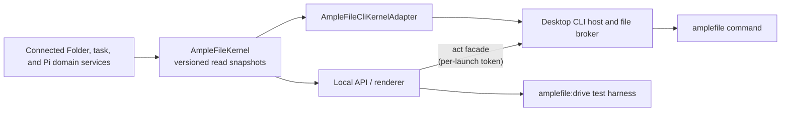

# The AmpleFile Agent and CLI

The **AmpleFile Agent** is the agent above all Connected Folders. In the
product, people see **Connected Folders**, **Workers**, and **Automations**;
technical contracts, commands, paths, schemas, and code identifiers use
`amplefile-agent`, `agent`, `management/`, `connected-folder`, and
`automation`.

This document covers the shared read authority (`AmpleFileKernel`), the
installed `amplefile` command and its act lane, the AmpleFile Agent, durable
requests, and the renderer transport. Per-verb classification, receipts, and
Recently Deleted are in [the act ledger](act-ledger.md); completion across
turns is governed by
[the collaboration contract](collaboration-contract.md#completion-delivery-and-recovery).

## What the AmpleFile Agent is

The AmpleFile Agent is one conversation scope above all Connected Folders,
reached through the menu-bar popover and `amplefile agent …`. It is the door
to every Connected Folder: material comes in through it (drops, attachments,
`files add`), what a person asks for gets done with a receipt, and nothing it
does is permanent at the moment it happens.

- **It is not a Connected Folder.** Its transcript is machine-local
  application state under the app profile's `management/` root and never
  travels with a folder. It has no Files or History of its own.
- **It is not a second persona.** It is the place and the conversation's
  name. Copy writes "the AmpleFile Agent", with "agent" lowercase and an
  article or possessive, never plural.
- **Its contract terms are fixed:** the CLI group `agent`, the
  `amplefile-agent` scope id, the `/api/amplefile-agent/*` routes, and the
  `management/` application-state root.
- **It is full trust, taught rather than caged.** See
  [its authority](#the-amplefile-agent-conversation) below. An enforced,
  tool-restricted management agent would be a separate, deliberate design.
- **It runs only when asked.** A continuation turn belongs to a request a
  person started and happens once per settle batch, within that request's
  limits. The only scheduled AmpleFile Agent turn is a declared Automation's
  `agent` step ([Automations](automations.md)). It is not a schedule, a
  watcher, or an event bus.

Terms used across these documents:

- **A request:** the machine-local record that owns one outcome: who asked,
  the turns and Connected Folders it spans, its questions, its results, and
  its usage. It lives under the state root's `requests/` directory, is
  reconciled against the turn journal after a restart, and is never
  replayed.
- **A question:** a durable record of one agent asking the person or its
  parent for something. One accepted answer delivers exactly one
  continuation turn in the asking Chat; a second answer, an answer after
  Stop, and an answer from a Connected Folder that does not own the question
  are refused.
- **A result envelope:** the one shape every report, handoff outcome, and
  Automation Chat hop produces: a summary, optional structured data,
  optional chosen files, and an outcome of succeeded, partial, or failed.
- **Waiting:** a host state, not a blocked process. `chat wait` and
  `agent wait` return when the task they follow settles or starts waiting,
  and say which; a parent turn finishes rather than sitting on a waiting
  child; and one continuation turn per settle batch carries the collected
  reports back.
- **A prepared act:** host-prepared typed facts, identity pins, an
  effect-time recheck, journal-first consumption, fenced execution, at most
  once, never auto-retried, run on the call that asks and answered with a
  receipt.
- **Setup-only authority:** act-token machinery, provider credentials, and
  settings administration. These have no model or CLI verb and never become a
  mid-task wait.
- **The overview:** a deterministic digest of running work, open questions
  and due snoozes, and what changed since the person last looked, composed
  by app code from recorded state with no model call
  ([the overview](amplefile-agent-overview.md)).

The taught behavior lives in `src/local/amplefile-agent-instructions.ts`;
prepared acts in `src/local/prepared-acts.ts`; Recently Deleted in
`src/local/recently-deleted-store.ts`; Automations under
`src/local/automations/`; the overview in `src/local/overview.ts` and
`src/local/overview-seen-store.ts`; and the verb families in
`src/local/cli/act-commands.ts` and `src/local/cli/act-facade.ts`.

## Why the kernel exists

The renderer, the command line, test harnesses, Extensions, and scripts all
need the same answers:

- Which Connected Folder applies to this actor and working directory?
- Which Connected Folders are registered?
- Which agent turns or Chat compactions are still running?
- Which Skills, Extensions, tools, packages, prompts, themes, and commands
  are available in this Connected Folder, and what are their scope, source,
  trust, and load states?

Those answers should not be reimplemented by every consumer. `AmpleFileKernel`
is the shared in-process read authority that produces them. It is
infrastructure, not another navigation item: **AmpleFile**, **Connected
Folder**, **Files**, **Chats**, **History**, and **Skills & Extensions** stay
the user-facing nouns.



Domain services own writes. The kernel does not bypass registered Connected
Folder authorization, capability-mutation locks, History behavior, or any
other mutation policy.

## Kernel contract

`src/local/amplefile-kernel.ts` defines `ampleFileKernelSnapshotVersion` and
a normalized actor context:

```ts
interface AmpleFileActor {
  kind: "human" | "assistant" | "cli" | "renderer" | "extension" | "system";
  cwd?: string;
  connectedFolderId?: string;
  conversationId?: string;
}
```

Connected Folder resolution is deterministic:

1. An explicit `connectedFolderId` wins.
2. Otherwise, the most specific registered Connected Folder whose root
   contains `cwd` wins. This matters when Connected Folders are nested.
3. Otherwise, the result has no Connected Folder context.

The snapshot version is `1` and exposes four read models:

| Snapshot | What it contains |
|---|---|
| `amplefile.context` | Normalized actor, resolution method, and resolved Connected Folder or `null`. |
| `amplefile.connected-folders` | Registered Connected Folder identities, roots, ownership and location metadata, and timestamps. |
| `amplefile.tasks` | Running `assistant_turn` and `compaction` records, optionally scoped to one Connected Folder. |
| `amplefile.capabilities` | Pi's authoritative capability catalog plus packages, project authorization, mutation eligibility, provenance, diagnostics, and validated Extension surfaces for one Connected Folder. |

The local API and the desktop CLI share one kernel instance. Agent turns and
Chat compactions register a task when work is accepted and finish it in
success and failure cleanup paths. An idle Chat whose context has passed 80%
of the point where Pi would compact it mid-turn is summarized in the
background about ten seconds after its reply, as a `compaction` task with a
`system` actor. It runs only when Pi's automatic compaction is on, never
refuses the person, and is cancelled by a new message, a manual compaction,
Make a Copy, deletion, or Quit, after which Pi still compacts mid-turn if it
must. Pi's own mid-turn compaction stays inside its turn's task. Capability
mutations are blocked while affected work is active, so a catalog reload
cannot silently end a background turn.

Capability snapshots are projections of Pi's native catalog. They do not
create a second full-trust registry, activate inactive tools, bypass the
Connected Folder registry, or install anything.

Trusted Chat streams also carry throttled `runtime` snapshots during native
Pi activity. Streaming text uses Pi's own token estimator until finalized
usage is available; reconnect refreshes the current runtime. A successful
compaction appends a presentation-only `system` message with kind
`context_compaction`, then publishes `context_compacted` with that saved
message. Manual, automatic, and background compactions share this path. The
notice contains no summary text, does not become a model message or result,
and stays visible in the window and the popover. Failure and cancellation
leave no success notice.

The kernel and its adapters read only AmpleFile's own profile and
`.amplefile/` data.

## Renderer transport

The desktop and local browser renderer share one authenticated
`POST /api/events` SSE connection per renderer across Chat, AmpleFile Agent
Chat, Connected Folder file-monitoring, and control subscriptions. The
request carries at most 128 uniquely identified subscriptions to exact
supported local stream paths, within a 64 KiB body. Each Chat consumer keeps
its own replay cursor, including two consumers of the same Chat. Changing
subscriptions aborts and drains the old connection before its replacement
opens; late frames cannot reach the new subscription generation. This keeps
start, answer, and Stop requests clear of Chromium's HTTP/1.1 connection
limit even with many background Chats.

The direct GET streams remain available. The closed `reset`,
`connected-folders`, `assistant`, and `activity` control hints contain no
content or authority; renderers re-read the relevant service after a hint and
reset on reconnect. `GET /api/connected-folders/activity` returns only the
Connected Folder and Chat ids of running Worker turns, including turns no
window shows; the renderer uses it for activity dots and records unseen
replies locally. `GET /api/connected-folders/outline` reads registered ids,
names, and roots without rewriting portable manifests; composers use it to
address Workers. File watchers have no replay log and refresh the file list
after every ready signal, covering changes during reconnection. Chat replay
keeps its event log and transient Extension interaction snapshots.

A removed or failed subscription closes independently; removing a Connected
Folder also closes its file watchers. Parent disconnect disposes every child
watcher and timer. The host caps physical connections, sends heartbeats, and
bounds the aggregate queued output to 512 KiB. Origin and renderer-session
checks still apply before admission. This is explicit renderer transport, not
a model or workflow event bus, an act verb, or arbitrary HTTP forwarding.

Successful agent configuration changes emit `assistant` after idle-client
invalidation, whether they came from Settings or the CLI. Empty composers
re-read the saved default; existing Pi sessions keep their own model.
Settings refreshes clean forms while keeping unsaved edits. Connected Folder
hints first reconcile the registry, then refresh catalogs only for surviving
registrations, so an obsolete request cannot restore a removed Connected
Folder or report a late error from it.

Live Extension questions use their own routes.
`GET /api/amplefile-agent/conversations/:id/extension-ui` and its Connected
Folder equivalent return current live Pi questions;
`POST .../extension-ui/:requestId` validates one response for that exact
Chat. Chat SSE sends `extension_ui_snapshot` on connection and change without
putting prompts or answers in its replay log. These session-local callbacks
are not durable request questions and never start a continuation turn; see
[Skills & Extensions](skills-and-extensions.md#live-extension-questions).

### Local context diagnostics

The development `GET /api/model-context` and `GET /api/model-context/:id`
routes read retained local diagnostics; optional `connectedFolderId` and
`conversationId` filters pin the exact owner, and a conversation filter
requires a Connected Folder filter. `POST /api/model-context` accepts either
`{ enabled: boolean }` or `{ clear: true }`. These use the local renderer
authentication, have no CLI operation, never create a client or Pi session,
and cannot influence execution. The all-request view opens in the installed
app only through an explicit launch argument and its own diagnostics-only
sandboxed window. Disabling, clearing, expiry, and shutdown discard the
memory-only records. See
[model context inspection](tool-feedback.md#inspect-model-context).

## The amplefile command

The Mac bundle places the extensionless `amplefile` shim and
`amplefile-cli.jxa.js` under `AmpleFile.app/Contents/bin`; AmpleFile adds that
directory to child-process `PATH` for Pi shell tools without editing a
person's Terminal profile.

### Other AI agents (Settings → Command Line)

Claude Code, Codex, or any agent that runs shell commands can drive AmpleFile
through this command. **Settings → Command Line**, also offered in first run,
has two parts, and nothing changes until the person clicks:

- **Add to Terminal** writes one line, the app's own `Contents/bin`, to
  `/etc/paths.d/<command>`, which every login shell reads. macOS asks for the
  person's password once. The launcher finds the app from its own folder, so
  the PATH names that folder rather than a symlink. It is offered only by an
  installed Mac app running from its own place (not a translocated download
  copy); the row says when another copy's entry is there, and **Remove**
  deletes the line.
- **AI Agents** writes the Skill to `~/.claude/skills/<command>/SKILL.md`
  (Claude Code) or `~/.codex/skills/<command>/SKILL.md` (Codex), shows when an
  app update changed it, and removes only a Skill whose front matter names
  this one. **Copy Skill** hands it to any other agent. `amplefile skill`
  prints the same file.

The Skill (`src/shared/outside-agent-skill.ts`) is short on purpose: the
rules (`--json`, an explicit `--connected-folder`, receipts over raw edits,
no secrets, no polling), how to look around, handing work to a Worker and
waiting for its result, asking the AmpleFile Agent to work across Connected
Folders, files and undo, and Automations, with `amplefile help <command>` for
the rest. Its product name, command, and folder come from
`src/shared/product-identity.json`, and `tests/outside-agent-skill.test.ts`
checks every command it cites against the help.

### The read lane

```sh
amplefile context --json
amplefile connected-folders list
amplefile tasks list --connected-folder "Home"
amplefile capabilities list --connected-folder "Home" --json
amplefile version
amplefile help capabilities
```

`connected-folders list --json` adds `parentConnectedFolderId` to a Connected
Folder registered inside another Connected Folder's folder.

`--connected-folder <id-or-exact-name>` selects a Connected Folder
explicitly. Without it, Connected Folder–aware read commands resolve the
terminal's current working directory. Duplicate exact names are refused as
ambiguous; use the stable id in scripts. `--json` emits the stable protocol
projection and is the preferred interface for scripts and shell-capable
agents.

Read commands stay content-free: Connected Folder names and paths, task
metadata, and capability metadata; no file contents, conversation text,
credentials, or provider tokens. The capability projection does not emit
Extension surface block contents.

### The act lane

The same command carries the **act lane**, the separately versioned,
per-launch-authenticated surface through which a shell-capable agent
operates the product while the app is running:

```sh
amplefile chat create --connected-folder "Home"
amplefile chat send --connected-folder "Home" --new --message "File the material I dropped."
amplefile chat send --connected-folder "Home" --conversation <id> --message-file notes.md
amplefile chat status --connected-folder "Home" --task <task-id> --json
amplefile chat wait --connected-folder "Home" --task <task-id> --timeout 900 --json
amplefile chat result --connected-folder "Home" --conversation <id> --messages 5 --json
amplefile chat abort --connected-folder "Home" --conversation <id>
amplefile chats list --connected-folder "Home" --json
amplefile connected-folders create --name "Vendor Audits"
amplefile connected-folders register --path /Users/me/Projects/existing-folder
amplefile files add --connected-folder "Vendor Audits" --from ./report.pdf --to "Inbox" --json
amplefile agent send --message "File everything I dropped into the right Connected Folders."
amplefile agent send --message "Put this where it belongs and start a review." --attach ./report.pdf --attach https://example.com/owner/project
amplefile agent wait --task <task-id> --json
amplefile agent status --task <task-id> --json
amplefile agent stop --task <task-id> --json
amplefile chat report --connected-folder "Home" --task <own-task-id> --summary "Filed three invoices." --file "Invoices/2026-09.pdf" --json
amplefile chat ask --connected-folder "Home" --task <own-task-id> --question "Which quarter?" --to parent --json
amplefile chat answer --connected-folder "Home" --question <question-id> --answer "Q3." --json
amplefile chat handoff --connected-folder "Home" --task <own-task-id> --to-connected-folder "Vendor Audits" --message "Review the filed invoices." --file "Invoices/2026-09.pdf" --json
amplefile requests list --json
amplefile requests show --request <request-id> --json
amplefile jobs start --connected-folder "Home" --task <own-task-id> --command "npm run build" --name "Build" --json
amplefile jobs output --connected-folder "Home" --job <job-id> --until "ready|listening" --wait 120 --json
amplefile jobs stop --connected-folder "Home" --job <job-id> --json
amplefile tools disable --path <resource-path> --kind extensions --scope everywhere --json
amplefile tools enable --path <resource-path> --kind extensions --scope connected-folder --connected-folder "Home" --json
amplefile recently-deleted list --json
amplefile recently-deleted restore --entry <recently-deleted-id> --json
```

`tools enable|disable` uses Pi's resource filters for `extensions`, `skills`,
`prompts`, and `themes`. The desktop and CLI share the prepared
`capability.resource.enabled` operation: resolve the exact catalog resource
and scope, pin resource bytes and settings, journal, recheck under the
capability fence, then write one native filter. Included resources use this
same path. Unrelated package defaults and filters are kept; active work
refuses the change rather than being interrupted. Native single-file package
sources do not support filtering and say so. Connection readiness is separate
from enablement: setting up an included tool's secrets stays local and has no
act operation. See [Extensions and computer work](extension-foundation.md).

The four collaboration verbs are Connected Folder–scoped, receipted, and
delivered by the host: `chat report` attaches one result envelope to the
caller's own running turn; `chat ask` records a question and puts that task's
request in `waiting` without suspending the turn; `chat answer` records
exactly one answer and starts exactly one linked continuation turn in the
same Chat (the turn store dedups it under `answer-<question-id>`, so a
replayed answer returns the same turn); and `chat handoff` copies the named
files into the destination through the same additive, restore-pointed path
as `files add` and then starts a new Chat there as a child of the caller's
request. `requests list|show` read the request graph, and `chat wait` and
`agent wait` settle on a terminal turn **or** on a task that is waiting,
saying which; the status documents carry `waiting` and the request reference
beside the turn state. See
[Durable requests, questions, and continuation](#durable-requests-questions-and-continuation).

`amplefile jobs …` drives **background jobs** ([Background jobs](background-jobs.md))
with the same service and records as the `job_start`, `job_output`, and
`job_stop` tools every Worker and the AmpleFile Agent carry. `jobs start` runs
a shell command for the caller's own running turn (`--task`, checked like
`chat report`) in its own process group, journaled before it spawns and never
re-run; the job joins that turn's request, which reads `working` while it
runs. Every verb names the job's Connected Folder, so a Worker reaches only
its own Connected Folder's jobs; the AmpleFile Agent's own jobs are reached
through its tools and listed by `requests show`. `jobs output` reads the end
of the output or a page from `--offset`, can `--wait` up to 600 seconds for
the end or until `--until` matches a line (read again to keep waiting), and
with `--task` naming a running turn in the job's own Chat counts as the job's
delivery. When a job ends, the host
captures History for its Connected Folder and brings the exit status, that
coverage, and the end of the output back to its Chat once: through a read,
the next turn's context, or one follow-up turn. Stop on the request and
quitting AmpleFile stop jobs; a restart records a running job `interrupted`
and wakes nothing. Output lives under the state root's `jobs/` directory and
follows the request retention window. Deletion, disconnecting, and
whole–Connected Folder History restore wait for running jobs; Skills &
Extensions changes do not.

`amplefile recently-deleted …` reads and restores
[Recently Deleted](act-ledger.md#recently-deleted). Like `automations` it
sits above Connected Folders, so neither verb takes `--connected-folder`;
each item names the Connected Folder it came from. `recently-deleted list` is
content-free: ids, kinds, paths, sizes, and dates. `recently-deleted restore`
puts one item back where it came from, renaming it when something else took
the name; a Skill goes back to the same scope and path and loads with the
next turn, and is refused while a Skill of the same name is installed there;
an Everywhere Skill names the AmpleFile Agent's scope id as its Connected
Folder. Nothing empties the store but the retention window set in
Settings → Recently Deleted.

### Act command behavior

Connected Folder–targeted act commands never resolve a Connected Folder from
the working directory; every write names its Connected Folder.
`connected-folders worker show` is a content-bearing act read that returns
the current default, only already-connected model choices, and instruction
text; `connected-folders worker model` saves the default for new Chats, and
`connected-folders worker instructions` changes subsequent turns. Both
setters reserve the Connected Folder–scoped agent mutation fence across
validation, write, and client invalidation, and their receipts contain model
identifiers or an instruction character count, never instruction text.
Provider credentials and connection setup have no act verb.

`chat send` accepts a CLI-started agent turn through the same acceptance path
as the window: conflict checks, stable request identity, durable acceptance
before the transcript append, a kernel task record with a `cli` actor,
portable transcript persistence, and pre- and post-turn History checkpoints.
It returns a task id. The act envelope's request id is the turn's idempotency
key, so an uncertain delivery cannot create a second agent run. Terminal
failures and explicit stops append a typed, sanitized agent result before
the task settles, including setup failures that happen before a provider can
answer; the same rule covers the machine-local AmpleFile Agent transcript and
the popover, while raw provider diagnostics stay in the host.

That task id is how a caller follows exactly its own turn. AmpleFile keeps
recent terminal outcomes (`succeeded`, `failed`, or `aborted`, with the
persisted response message id or failure message) in a bounded machine-local
journal across restarts. `chat status --task` and `chat result --task` read
it, and `chat wait --task` is a poll in the shim that finishes with that
turn's own result: a failed or aborted turn exits non-zero instead of
presenting an older transcript message as success (a wait timeout exits 7).
`chat status|result --conversation` are the transcript-scoped views.

On startup, an accepted turn that reached its transcript but never settled is
recorded as interrupted and is not rerun automatically, because completed
tools may already have changed something. Quitting AmpleFile mid-turn records
the turn the same way (interrupted, reported as failed), never as a Stop the
person asked for. The Chat's last interrupted reply offers **Continue**,
which sends the ordinary visible message "Continue where you left off." as a
new turn, without the files staged in the person's draft; nothing is
replayed. A tool call that never recorded a result reaches the model as an
honest error saying it may have partly happened and its effects should be
checked.

`files add` copies outside material in with a targeted restore point that
succeeds or fails together with the placement, and `connected-folders create`
and `connected-folders register` grant the same runtime authorization as the
window's actions. Content-bearing Chat and agent-preference reads
(`chat status|result`, `chats list`, `connected-folders worker show`) belong
to the act lane, so the read lane stays content-free. When the interactive
app is not running, act commands fail fast with "Open AmpleFile…" and exit
code 6.

Deleting a Worker Chat moves its portable transcript into Recently Deleted
and records the Connected Folder, Chat, and Recently Deleted entry identities
in its receipt.

## The AmpleFile Agent conversation

`amplefile agent …` talks to the AmpleFile Agent. It reuses the same
acceptance path, Pi runtime, kernel task records, and task-scoped outcome
semantics as Connected Folder Chats, under the scope id `amplefile-agent`
instead of a Connected Folder id. Its transcript lives under the app
profile's `management/` root: it describes this computer's registry, so it is
not portable Connected Folder data. Its Pi session loads Everywhere Skills
and Extensions plus exactly two app-materialized project resources, an
`AGENTS.md` context file and the `manage-connected-folders` Skill, rewritten
on every start. It gets no user Connected Folder's `.pi` configuration and no
History checkpoints (History belongs to Connected Folders).

Those two app-owned resources are required. If AmpleFile cannot write them
safely, ordinary Connected Folders and the window may still start, but
AmpleFile Agent commands fail closed until its folder can be prepared;
AmpleFile never runs this full-trust scope as an unidentified, uninstructed
agent.

Its authority, precisely: the AmpleFile Agent is **full trust, taught rather
than caged**. Like every agent in AmpleFile it keeps Pi's ordinary read,
bash, edit, and write tools, which accept absolute paths anywhere this user
can reach. Its instructions teach it to prefer the `amplefile` read and act
commands for anything that touches Connected Folders, because those carry the
trust grants, restore points, receipts, and conflict rules. That preference
is instruction, not an enforced boundary.

Without `--conversation`, agent commands target the most recent active
AmpleFile Agent Chat, `agent send` creates it on first use, and `--new`
starts another thread; AmpleFile Agent turns appear in `amplefile tasks list`
under its scope id. The popover offers the same choice as **New Chat**: the
view becomes a clean slate at once, the first send creates the new
machine-local transcript, and the previous transcript stays saved. A person
can rename or delete an idle AmpleFile Agent Chat there; deletion moves its
transcript into Recently Deleted under its Chat title, and restoring it keeps
that Chat identity. Running, compacting, or unsettled Chats refuse deletion.

### Attachments, request lineage, and the popover

`agent send --attach <path-or-link>` (repeatable, at most 16) attaches
**references, not copies**: absolute or working-directory-relative file and
folder paths, or http(s) links. A Connected Folder Chat stages dropped
material inside the Connected Folder because its transcripts travel with the
folder; the AmpleFile Agent's transcript is machine-local, so its attachments
carry absolute paths, missing sources are refused at send time, and the only
copy in the flow is the restore-pointed `files add` into a destination
Connected Folder. Readable files are inlined into the turn within the shared
context budget; folders, binaries, and oversized files stay path-only
references; links arrive as a typed list, never as fake files. The typed
references persist on the user message, and `--attach` rides in ordinary act
argv.

Every accepted AmpleFile Agent turn is a **request**. Its hidden turn context
supplies that request's task id and, like every Worker turn's, the host's
local time, time zone, and platform. Its instructions require
`--parent-task <id>` on `chat.send`, `files.add`, `connected-folders.create`,
and `connected-folders.register`. The act host checks that the named parent
is active before journaling or running the action; attributed actions become
the request's action trail, delegated turns become its children, and act
receipts gain the same `parentTaskId`. An unrelated CLI action is therefore
never credited merely because an AmpleFile Agent turn happens to be running,
and concurrent AmpleFile Agent turns stay unambiguous. This is lineage, not
caller authentication.

`agent status --task` reports a `request` object beside the turn:
per-attachment **dispositions** computed from recorded actions (`placed`,
`registered`, or honestly `unrecorded`), recorded actions with restore-point
ids, child turns with their own states, the reply, and a **phase**:
`working`, `needs_you` (an open question, or a reply whose final line asks
one), `handed_off` (the AmpleFile Agent turn finished but a delegated
Connected Folder turn still runs), `done`, `failed`, or `stopped`. The
record's own `state` travels beside the phase (`partial` reads as `done`
there), with the request id, root id, kind, and
bounded question and result references. Done requires the AmpleFile Agent
turn and every child to succeed; a failed or lost child fails the request,
and an aborted child or an accepted request-level Stop stays stopped. A
popover reply to `needs_you` joins the same request as a further turn,
carrying the prior attachments and action trail without replaying them into
model context, and it is recorded as the answer to any open question waiting
on the person. `agent stop --task` aborts the AmpleFile Agent turn and every
turn still running under that request, withdraws its open questions, and
names each turn it touched.

The **menu-bar popover** talks to the `/api/amplefile-agent/*` local API
routes (send with attachments, summary, request status, request stop,
transcript, per-conversation runtime and reasoning-level changes, and the
event stream) through the same acceptance path, conflict rules, and kernel
task records as every other surface. It is a separate window. Its transcript
is a compact conversation: the person's messages are colored bubbles on the
right, agent replies are unboxed on the left, and there are no speaker labels
or divider lines. It follows streamed text while pinned near the bottom but
respects deliberate scrollback. The header shows the current Chat title with
**Previous** and **New Chat**. The stream renders replay-safe
`turn_snapshot`, incremental `assistant_delta`, and final
`assistant_message` text in place; when the request settles, the persisted
transcript replaces that projection. The model label opens
**Settings → AI Models** scoped to **AmpleFile Agent**; the reasoning
selector is filled from the AmpleFile Agent's selected model before the first
send, saves Pi's default for a future session, and changes the live Pi
session once the conversation has one. The send action becomes **Stop** while
the request is active, and the text area stays available for drafting; one
compact live line carries the current activity. Dropping on the menu-bar icon
stages bounded references, and dragging over the popover turns its whole
surface into the drop target; neither sends anything. Its sandboxed renderer
has a dedicated preload exposing only the local API session, dropped-file
path resolution, hide and show of the main window, opening AI Models settings
(`openAiModelsSettings`), and window-material actions.

The authenticated renderer lists saved AmpleFile Agent Chats at
`GET /api/amplefile-agent/conversations` and pins
`GET /api/amplefile-agent/summary?conversationId=<id>` to a selected Chat. The
transcript and latest request always come from that same id.

The AmpleFile Agent has one machine-local provider and model preference,
separate from every Connected Folder's. Settings → AI Models labels that
scope **AmpleFile Agent**. Each registered Connected Folder may also keep
bounded machine-local **Worker instructions**, keyed by its portable identity
and appended to subsequent Pi turns without changing portable `.amplefile/`
or `.pi/` content. Saving them never waits on or interrupts work: idle Chats
pick them up at once, and a Chat that is mid-turn or compacting, including
the Worker that saved them, picks them up as soon as that work ends. Provider
credentials are machine-wide Pi auth storage records.

## Durable requests, questions, and continuation

[The collaboration contract](collaboration-contract.md) makes the request an
owned record. Every accepted turn (AmpleFile Agent, Connected Folder, CLI, or
Automation hop) joins one. An AmpleFile Agent turn creates a root;
`chat send --parent-task` creates a child under it; a Connected Folder turn
with no parent is its own root; a person's reply to a request waiting on
their answer joins that record. Records live under the state root's
`requests/` directory, survive restart, and are never replayed: after the
turn journal repairs itself at startup, every request still believed live is
reconciled against it, settled, and stamped as recovered so nothing continues
it. Settled request graphs are kept for 30 days. Transcripts and act receipts
are the long-lived content records, while the bounded machine-local turn
journal keeps acceptance identity, stream checkpoints, and recent terminal
outcomes.

A **request** carries its id, kind (`agent`, `connected-folder`,
`automation`, or `cli`), root id, parent task id, owner (a conversation id,
plus the Connected Folder id for Connected Folder work), initiating surface,
created-at, state, its turns, child request ids, question ids, results,
rolled-up usage, the assignment text, attachment references, and the
attributed action trail. Its state comes from one vocabulary: `working`,
`waiting`, `handed_off`, `done`, `partial`, `failed`, `stopped`. A
**question** carries its id, request id, task id, respondent (`person` or
`parent`), text, optional suggested choices (`--option`), asked-at, state
(`open`, `answered`, `cancelled`), the answer and answered-at, and the
continuation task id. A **result** is the envelope: `summary`, optional
`data`, optional `files` as Connected Folder–relative paths with a
fingerprint and size, and an `outcome` of `succeeded`, `partial`, or
`failed`, plus its task id, recorded-at, and receipt id.

`requests list` and `requests show --request <id>` read that graph. Like
`recently-deleted` and `automations` they sit above Connected Folders and
refuse `--connected-folder`. The graph carries every Connected Folder's
results and the AmpleFile Agent's own assignment text, so a caller whose
directory resolves to a registered Connected Folder (a Worker, or a harness
working inside one) is refused by name; a Connected Folder follows its own
work with `chat status`, `chat wait`, and `chat report`.

The four collaboration verbs refuse rather than gate. A `--task` must name
the caller's own turn. `chat ask --to parent` on a root with no parent goes
to the person, and `--to person` is the default; the asking turn ends rather
than suspending, and its request reads `waiting`. `chat answer` delivers
exactly one answer and starts exactly one linked continuation turn in the
same Chat; a second answer, a cancelled question, a stopped request, an
answer from a Connected Folder that does not own the question, and a busy
Chat are each refused by name. `chat handoff` copies the named files through
the same additive, restore-pointed path as `files add`, starts the
destination Chat through the ordinary acceptance path, and links it as a
child of the caller's root so its report flows back there. Delivery is the
host's job throughout: no AmpleFile Agent model turn is needed to move a
report, an answer, or a handoff.

Waiting is a host state. `chat wait` and `agent wait` settle when the
followed turn reaches a terminal state **or** when its task is waiting on an
answer, and say which; a waiting settle exits 0 and prints the status
document with its `waiting` field, because waiting is not a failure. A parent
turn never blocks on a child that is waiting for input: it finishes and
reports the request as `waiting`. When the owning Chat is idle, its children
have settled, and selected child results have not been delivered, the host
composes one deterministic follow-up turn in that conversation: a
`system`-actor turn joined to the root, naming each settled child, its
outcome, the files it chose, and any question still open beneath it.
Delivered child turns are recorded so a result is not delivered twice. A
child result the parent's still-running turn reads with `chat result` or
`agent result` (the last step of `chat wait`) counts as delivered too.
Continuations never follow a root Stop, a configured spending-cap failure, or
a restart, and a person can turn them off in Settings → Automations → Limits.
Compaction cleanup reevaluates deliveries the Chat deferred, including when
compaction fails. Synthesis uses the latest child turn's selected report and
files, or its failure or no-report status; older successes stay historical,
and partial or failed graph outcomes take precedence.

File deletion and Connected Folder removal use the same reservation against
active turns, compaction, and Automation file work, in the window and on the
CLI. Unfinished requests, waiting questions, and accepted continuations also
refuse deletion; after Stop, accepted turns must drain first. Deleting a
managed parent requires disconnecting nested Connected Folders first. A
refused delete changes no content and creates no safety checkpoint. See
[Recently Deleted](act-ledger.md#recently-deleted) for interrupted folder
and History moves.

Only the assignment text, answer text, released report summaries, and copied
files ever enter a Connected Folder Chat. The request graph itself, other
Connected Folders' results, and the AmpleFile Agent's transcript stay above
Connected Folders.

Requests have no lifetime, child-count, delegation-depth, or
continuation-count quota. One Chat runs one turn or compaction at a time;
different Chats and Connected Folders, including AmpleFile Agent Chats, can
run at the same time. Delegated children have no separate slot limit or
waiting queue.

Settings → Automations → Limits (`src/shared/amplefile-limits.ts`) shows the
request transport bounds, the optional spending budget, and retention:

| Limit | Default | On hit |
|---|---|---|
| Provider budget per root | unlimited (a host may set a cap) | request `failed`, names the cap |
| Question text | 4 MiB | the write is refused before it is recorded |
| Answer text | 4 MiB | the write is refused before it is recorded |
| Result summary | 4 MiB | the write is refused before it is recorded |
| Result data | 16 MiB | the write is refused before it is recorded |

Structured details are validated against the declared schema when there is
one. Long text rides `--summary-file`, `--question-file`, and
`--answer-file`. Named result files have no separate count quota; the
transport envelope still has its byte bound.

### Work presentation for trusted surfaces

`src/shared/request-presentation.ts` defines the version-1 work view. It
projects one request and its linked descendants into labels, available
actions, exact person questions, and selected results with file references
owned by their Connected Folder. It contains no sibling transcripts or
general request-graph access. Questions are shown four at a time, with the
remaining count; answering reveals the next ones.

The authenticated local API reads it through
`GET /api/connected-folders/:connectedFolderId/conversations/:conversationId/work`,
`GET /api/amplefile-agent/conversations/:conversationId/work`, and
`GET /api/tasks/:taskId/work`. Journaled
`POST /api/requests/:requestId/answer|stop|continue` uses the shared answer,
Stop, and turn-admission paths. Answers carry `questionId` and `answer`;
explicit continuations carry a stable `deliveryId`. A lost-response retry
acknowledges the accepted answer or turn rather than starting another one. A
continuation carries the selected child reports and records their delivery
before prompting. See
[Collaboration experience](collaboration-experience.md) for rendering,
recovery, keyboard, and privacy behavior.

[Worker tools](worker-tools.md) documents the structured collaboration
adapters, `chat ask --asynchronous`, `jobs start --interactive|--service`,
`jobs input`, and `worktrees manage`. These use this facade and explicit
Connected Folder and task lineage. Queued asynchronous answers return
`continuation: null` and `queued: true` until idle delivery starts the one
linked turn.

### Observed turn files

The optional `fileChanges` field in `amplefile.turn.v1` records full pre- and
post-turn History checkpoint ids and at most 64 changed or new file paths,
hashes, and sizes. It contains no file bytes and is admitted only on terminal
turns. AmpleFile Agent requests project at most 12 currently visible
child-file paths. The request trail is bounded by the same per-request limits
and 30-day retention as the rest of the record; turn metadata alone does not
reconstruct a request that retention removed.

## Bounded History review and durable turn evidence

`history read --connected-folder <id> --path <relative-file> --checkpoint <id> --json`
reads a selected saved file.
`history diff --connected-folder <id> --path <relative-file> --from-checkpoint <id> [--to-checkpoint <id>] --json`
compares two saved versions, or compares with the current file when the
second checkpoint is omitted. Both are authenticated act-lane reads with
metadata-only receipts. Local GET routes at
`/api/connected-folders/:id/history/read` and
`/api/connected-folders/:id/history/diff` take `path` plus `checkpointId` or
`fromCheckpointId`/`toCheckpointId` and call the same `history-review.ts`
service.

The service checks that the checkpoint belongs to the selected Connected
Folder and that the relative path is exact before opening an object. It
refuses internal paths, symlink traversal, and paths that belong to nested
Connected Folders. Read results distinguish text, binary, too-large, absent,
uncaptured, and unavailable content. Saved digests are verified against the
bytes read; `hashVerified: false` marks metadata that was not reverified.
Current reads carry `observedAt` and refuse detected changes during reading;
they are not transactional filesystem snapshots. Review never captures,
restores, or edits files. Interval differences do not attribute edits to a
Worker.

Each version-1 result states its complete-file budgets: 4 MiB per complete
text observation (and per read page), 4 MiB of difference output, 200,000
lines, 64 KiB per line, and sixteen million diff work cells. Unsupported or
incomplete comparison stays explicit in JSON and human output. Connected
Folder History and file Version History offer the same read-only comparison,
including coverage explanations and available saved and current text.

Search and History retrieval budgets are per call, with explicit
continuation. `history list` and `history versions` accept `--limit`
(1–1,000) and `--cursor`; their arrays come with `total`, `sourceVersion`,
and `nextCursor`. Pass `nextCursor` with the same selection until it is null.
A changed retained ledger or a cursor from another selection is refused
instead of silently moving the page boundary. The matching checkpoint and
file-version GET routes accept `limit` and `cursor`.

For a large saved UTF-8 file, use
`history read --connected-folder <id> --path <file> --checkpoint <id> --offset-bytes 0 --length-bytes 65536 --json`.
The `range` field contains text, actual byte offset and length,
`totalBytes`, `hashSha256`, `hashVerified`, and `nextOffsetBytes`. Repeat
with that next offset and `--expected-sha256 <hash>` until the next offset is
null. Each call streams and verifies the whole checkpoint-owned object with
fixed buffers before releasing any selected text, so corruption outside the
requested range is caught. Ranges keep UTF-8 character boundaries; offsets
inside a character are refused. `range.complete` means the one returned range
covers the whole file. `observation.text` always means complete content; a
large observation can be `too_large` while its separate range is available.
HTTP uses `offsetBytes`, `lengthBytes`, and `expectedSha256`. Binary and
uncaptured content stay explicit.

`search --connected-folder <id> --query <text> [--scope files|chats|all] [--path <file-or-folder>] [--limit <n>] [--cursor <cursor>] --json`
streams ordinary text files regardless of size. `path` narrows the file
portion; Chat scope stays separate. The response has `files`, `chats`,
`truncated`, `scannedFiles`, `nextCursor`, and per-page `coverage`. Repeat
the same selection with the returned cursor until it is null; a page with no
matches can still advance through a large file. The defaults are 200
matches, 5,000 visited entries or files, and 8 MiB scanned per page, with
fixed read buffers and a 512 KiB match-payload budget. Ignored directories,
internal metadata and nested Connected Folders, symlinks, binary content,
unreadable entries, and detected changes have separate coverage counts.
Directory counts name excluded roots, not all descendants.
`coverage.complete` is false while work remains or any page met unreadable
or changed content. Search is a sequence of live observations, not a
transactional snapshot. Cursors bind the selection and ignore rules, verify
active directory and file identities, and expire on host restart. Local
Search GET uses `q`, `scope`, `path`, `limit`, and `cursor` with the same
service and request cancellation.

A Connected Folder turn's hidden context includes the actual pre-turn History
capture: checkpoint id (including deduplicated reuse), captured file count,
and skipped counts by reason, or an unavailable status. It does not claim
skipped bytes are backed up. AmpleFile Agent turns do not imply a checkpoint
covers arbitrary external files or every Connected Folder. The instructions
distinguish ordinary native Pi content work from managed product operations,
and keep explicit History saves for useful intermediate milestones.

Turn-store retention applies a 1,000-record default to recent terminal
records; all accepted and running records stay through replay and
compaction. The transient `TurnCheckpointWriter` owns batching and draining
stream writes, including task-id fencing and shutdown, while the turn store
owns durable records.

Optional `assistantPresentation` on saved assistant messages records at most
256 native segment boundaries as UTF-16 offsets into the unchanged `content`,
classified as progress, final, or command. A successful native stop without
tool calls can mark a final segment; stopped or incomplete turns keep
progress, and malformed metadata is ignored. Selected native edit evidence is
described in
[the feedback contract](tool-feedback.md#selected-edit-evidence-and-presentation).

## Desktop handoff

The public command does not run Electron as Node; the `RunAsNode` fuse stays
disabled. It uses a bounded protocol-v1 file handoff instead:

1. The shim writes an atomic UUID-named request under the owning app's
   profile, with the arguments, current working directory, protocol version,
   and timestamp. An installed production app uses
   `~/Library/Application Support/AmpleFile/cli/requests`, and the separately
   identified local smoke app uses its own product directory. Packaged child
   commands receive that exact root through the CLI-only
   `AMPLEFILE_CLI_STATE_DIR`; desktop state selection never reads it.
2. It starts or contacts the exact installed app executable with that request
   id. Electron's single-instance handoff routes the request to the running
   desktop host when the app is already open.
3. The desktop host claims the request on arrival, executes it through
   `AmpleFileCliKernelAdapter` or the act executor in one serial queue, and
   atomically writes stdout, stderr, structured result, and exit code under
   `responses`. `jobs output` and `chat compact`, which can take minutes and
   are fenced by their own services, run beside that queue so they never
   stall other commands.
4. The shim returns that output and removes its request and response files.
   The broker also removes stale bounded files during initialization.

A CLI-only launch can start the host, process its queue, flush Pi state, and
exit without showing the window. If the window is already open, the command
uses the same kernel and live task registry. A headless request coexists with
the running single-instance app, returns bounded stdout, stderr, and exit
status, and never opens or steals focus from the window.

The broker refuses unsafe roots, symbolic-link or non-regular request files,
path escapes, oversized payloads, stale timestamps, future clock skew,
duplicate claims, and unsupported fields. These checks make the handoff
bounded; they do not authenticate the caller.

## Security boundary

The CLI directory is a same-user coordination channel, not a public API or
authenticated caller boundary. Another process running as the same user may
be able to submit requests and read the resulting local metadata. Protocol v1
therefore stays read-only; mutations are never added to it.

The act lane is the separately versioned write surface
(`src/local/cli/act-protocol.ts`, protocol version 3), in the smallest form
that is honest for a personal, local product:

- **Per-launch request authentication.** The interactive app mints a random
  act token every run, writes it to `cli/act-token.json` (mode 0600), and
  removes it on shutdown. Shims attach the token to each act request; the
  desktop host compares it in constant time. On a single-account Mac the OS
  user is the principal: the token binds requests to *this app run* and keeps
  stale or crash-residue requests inert; it does not pretend to distinguish
  same-user callers. An older shim is refused with the typed version error.
- **Freshness and at-most-once execution.** Act requests reuse the broker's
  bounded, atomic, freshness-checked claim path; a pending request id returns
  its recorded response, and after the shim cleans up, the journal's
  `accepted` records refuse a duplicated id outright. The broker refuses
  requests older than its freshness window, and journal rotation holds
  entries at least that long, so the two compose into a durable at-most-once
  guarantee.
- **Explicit scope.** Every act command names its Connected Folder; writes
  never resolve from the working directory. Chat commands also name their
  conversation or task.
- **Journal-first receipts.** Every authorized act command appends an
  `accepted` line to `cli/receipts/act.jsonl` **before** its mutation runs
  (an unwritable journal refuses the command) and a terminal `ok` or `error`
  line after. Receipts record the initiating surface (`cli`, `popover`,
  `main-window`) and typed undo references, including Recently Deleted entry
  ids: identifiers and digests only, never content. A crash can separate the
  pair, but an applied action can never be missing its `accepted` trace; a
  missing terminal record is itself the honest signal that the outcome was
  interrupted.
- **Existing domain checks.** Act execution goes through an in-process facade
  the interactive local API exposes, reusing the same route internals as the
  window: Connected Folder trust grants, capability-mutation locks,
  turn-conflict refusal, History checkpoints, and kernel task records.
  Without the running app there is no facade and nothing changes.
- **Prepared acts.** Runnable-code, standing-power, and destruction acts
  prepare a fully pinned record, recheck every pin at effect time, consume it
  journal-first, and execute at most once through a fenced kernel task,
  immediately on the call that asks. There is no pending state, card, expiry,
  denial, or authority mode; failed and interrupted executions are never
  auto-retried; destruction is reversible through History or Recently
  Deleted. The act facade exposes no secret entry.

## Agent harness versus management CLI

The management CLI inspects and operates the running product.
`amplefile:drive` serves a different purpose: it runs one real Pi turn
through the same local API, built-in tools, Skills, Extensions, persistence,
and event stream as the app.

```sh
npm run amplefile:drive -- --connected-folder-root /path/to/folder --prompt "Summarize the files in this Connected Folder"
npm run amplefile:drive -- --connected-folder-root /path/to/folder --prompt "..." --json --agent-dir /tmp/isolated-pi
npm run amplefile:drive -- --connected-folder-id <id> --attach http://127.0.0.1:4327 --prompt "..."
```

Useful options include `--prompt-file`, repeatable `--context`,
`--conversation`, `--attach`, `--agent-dir`, `--timeout`, `--json`, and
`--quiet`. In-process runs use temporary AmpleFile application state unless
`AMPLEFILE_STATE_DIR` is set. Provider credentials come from Pi auth storage
or standard provider environment variables.

Use the CLI to assert management snapshots. Use `amplefile:drive` to test
actual agent behavior end to end.

`amplefile:appearance` is a third, inert development primitive. It creates
and validates a bounded Connected Folder appearance proposal that Codex or
Claude Code can hand to a person for import in the window. It does not
contact the running product or change state, so it is not a protocol-v1
command. See [Connected Folder customization](connected-folder-customization.md).

## Not provided

This layer does **not** provide:

- a headless act lane (act commands need the running app, where the turn
  runtime lives);
- Chat-scoped or individually revocable authorization beyond the per-launch
  act token;
- a tool-restricted or independently permissioned agent above Connected
  Folders beyond the full-trust, taught AmpleFile Agent;
- event subscriptions for all state changes;
- imperative APIs for Extensions to create or change window surfaces;
- a verified registry that binds a Connected Folder–local service to a
  process AmpleFile launched.

New features of this kind should extend the kernel's read authority instead
of reaching around it.

## Implementation and verification map

| Area | Source | Primary tests |
|---|---|---|
| Versioned snapshots and context resolution | `src/local/amplefile-kernel.ts` | `tests/amplefile-kernel.test.ts` |
| Compact CLI projection | `src/local/amplefile-cli-adapter.ts` | `tests/amplefile-cli-adapter.test.ts` |
| Protocol, parsing, output, and exit codes | `src/local/cli/protocol.ts`, `src/local/cli/commands.ts` | `tests/amplefile-cli-protocol.test.ts` |
| Act request schema and envelope dispatch | `src/local/cli/act-protocol.ts` | `tests/amplefile-cli-act-protocol.test.ts` |
| Per-launch act token file | `src/local/cli/act-token.ts` | `tests/amplefile-cli-act-token.test.ts` |
| Act receipts | `src/local/cli/act-receipts.ts` | `tests/amplefile-cli-act-receipts.test.ts` |
| Act argv parsing and executor | `src/local/cli/act-commands.ts` | `tests/amplefile-cli-act-protocol.test.ts`, `tests/desktop-amplefile-cli-host.test.ts` |
| Act facade over route internals | `src/local/server.ts`, `src/local/cli/act-facade.ts` | `tests/amplefile-act-facade.test.ts` |
| Atomic bounded file broker | `src/local/cli/broker.ts` | `tests/amplefile-cli-broker.test.ts` |
| Electron single-instance host | `desktop/src/amplefile-cli-host.ts`, `desktop/src/main.ts` | `tests/desktop-amplefile-cli-host.test.ts` |
| CLI shims and child-process PATH | `desktop/cli/`, `desktop/src/main.ts` | `tests/desktop-cli-packaging.test.ts` |
| Real Pi turn driver | `scripts/amplefile-drive.ts` | Run against the local API when provider credentials are available. |
| Machine-wide Automation scheduling | `src/local/agent/amplefile-scheduler-service.ts` | `tests/amplefile-scheduler-service.test.ts` |
| Prepared acts | `src/local/prepared-acts.ts` | `tests/prepared-acts.test.ts`, `tests/amplefile-cli-act-receipts.test.ts` |
| Recently Deleted | `src/local/recently-deleted-store.ts` | `tests/amplefile-recently-deleted-store.test.ts`, `tests/amplefile-cli-recently-deleted-verbs.test.ts`, `tests/recently-deleted-settings.test.ts` |
| Durable requests | `src/local/requests/request-records.ts`, `src/local/requests/request-store.ts` | `tests/amplefile-request-store.test.ts`, `tests/agent-requests.test.ts`, `tests/amplefile-request-integration.test.ts` |
| Connected Folder turn context and operations guide | `src/local/agent/connected-folder-turn-context.ts`, `src/local/agent/connected-folder-operations-guide.ts` | `tests/connected-folder-turn-context.test.ts`, `tests/connected-folder-operations-guide-prompt.test.ts`, `tests/amplefile-agent-turn-context.test.ts` |
| Turn environment line and role preamble | `src/local/agent/turn-environment.ts`, `src/local/agent/role-preamble.ts` | `tests/turn-environment.test.ts`, `tests/role-preamble-prompt.test.ts` |
| Report, ask, answer, handoff, waiting, and continuation | `src/local/cli/act-commands.ts`, `src/local/cli/act-facade.ts`, `src/local/server.ts` | `tests/amplefile-collaboration-verbs.test.ts`, `tests/collaboration-result-envelope.test.ts`, `tests/amplefile-collaboration-journeys.test.ts` |
| Bounded inference | `src/local/agent/bounded-inference.ts` | `tests/bounded-inference.test.ts` |
| Automation declarations, store, settle signals, and executor | `src/local/automations/` | `tests/amplefile-automation-declarations.test.ts`, `tests/amplefile-automation-store.test.ts`, `tests/amplefile-automation-settle-signal.test.ts`, `tests/amplefile-automation-service.test.ts` |
| Overview composition and seen markers | `src/local/overview.ts`, `src/local/overview-seen-store.ts` | `tests/amplefile-overview.test.ts`, `tests/amplefile-overview-seen-store.test.ts` |

See [Architecture](architecture.md) for the surrounding process boundaries,
[Product model](product-model.md) for the user-facing mental model, and
[macOS build lanes](macos-build.md) for packaging and release verification.
