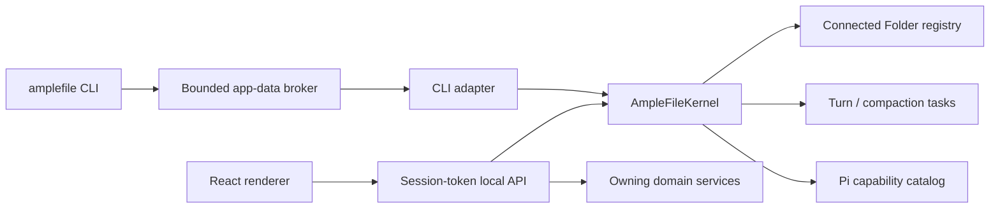

# Architecture

AmpleFile has three runtime layers and one shared in-process management plane:

1. The React renderer draws the file manager window (sidebar, toolbar,
   contents, path bar, and the right panel with Info, History, and the Chat),
   the Skills & Extensions and Settings dialogs, and, as a separate renderer,
   the AmpleFile agent's menu-bar popover.
2. The local Node host owns filesystem access, conversations, resource
   import, Pi sessions, and the domain services that authorize changes.
3. Electron supplies native windows, menus, dialogs, secure storage,
   lifecycle, and packaging.

In the packaged app, the local Node host runs inside Electron's main process;
development mode can run it as a separate local process beside Vite. Inside
that host, `AmpleFileKernel` is the read-only control plane shared by the
local API, the renderer, and the CLI. It resolves actor context and returns
versioned Connected Folder, task, and capability snapshots. It is not another
process, database, public HTTP service, or mutation authority.

The renderer never receives provider secrets or unrestricted filesystem
access. Native and filesystem operations cross typed API or preload
boundaries.

## Shared management plane

The desktop host creates one `AmpleFileKernel` and passes it to both
`startLocalApi` and `AmpleFileCliKernelAdapter`. The renderer, the local API,
and the installed CLI therefore share one live registry of agent work.
Scripts such as `amplefile:drive` use the same semantics and code path but
normally create their own temporary host unless they attach to a running
development API.

An actor includes its kind and may include a current directory, Connected
Folder id, or conversation id. An explicit Connected Folder id wins;
otherwise the deepest registered Connected Folder root containing the
actor's current directory wins. Snapshots carry a compatibility version and
cover context, registered Connected Folders, running agent turns and Chat
compactions, and Pi capabilities with packages, trust, provenance, and
diagnostics.

The kernel observes and projects domain state; it does not own writes.
Renderer changes still pass through local API handlers, registered Connected
Folder authorization, capability-mutation locks, filesystem safety, and
History. Agent turns and compactions register a kernel task at acceptance and
finish it in cleanup paths. Capability mutations are refused while affected
work is active.

The public `amplefile` command uses a compact adapter that omits content. Its
protocol-v1 request and response files live under
`~/Library/Application Support/AmpleFile/cli`; Electron's single-instance
handoff lets a command contact the running app or start a headless host. The
channel is bounded and same-user, but not authenticated, so it stays
read-only; changes go through the separately authenticated act lane. See
[the AmpleFile agent and CLI](amplefile-agent-and-cli.md) for the full
snapshot, adapter, CLI, and security contracts.

## Product model and navigation

**AmpleFile** is the product. A **Connected Folder** is its unit of work: an
understandable context for an activity, backed by one ordinary folder.
**New Connected Folder** creates a managed folder; **Connect Folder**
registers an existing folder in place. Neither converts the person's files to
an application-specific format.

The window is a file manager ([product model](product-model.md#the-file-manager-window)).
The sidebar lists Recents, the Standard Folders, and every Connected Folder,
with nested ones indented under their parent. For the Connected Folder shown:

- **Files** are its ordinary folder contents, in list or icon view.
- **Chats** are its conversations; the History tab lists them under its
  changes, and a Chat opens in the right panel.
- **History** lists its restore points and recoverable changes, or one
  file's versions.
- **Skills & Extensions** is one dialog, opened from the Action menu and
  pinned to the Connected Folder it was opened from, with Installed and
  Discover views for Skills and Extensions available Everywhere or from one
  Connected Folder. Package provenance and lifecycle live there.

Provider, model, and authentication configuration lives in **Settings → AI
Models**.

The concepts have different scopes and trust levels. Ordinary files are
passive. Skills influence how the agent works and may include scripts.
Extensions run code or reach other systems and so need stronger, explicit
trust. Sharing one management dialog does not collapse those differences:
type, provenance, scope, load state, diagnostics, and package contents stay
visible. Making something available never silently activates it or adds it to
a Chat's context.

Every Chat belongs to one Connected Folder. An accepted Pi turn keeps running
in the app-owned local API while another folder is shown, the window is
minimized, or the last window is closed and later recreated from the Dock.
Event-stream reconnects use the server's turn-state snapshots and the saved
transcript, so renderer sleep, window recreation, or wake does not lose the
result.

The AmpleFile agent popover is a small separate frameless window
(`popover.html`, its own lean renderer entry) owned by the menu-bar
integration. It loads through the same app protocol, session-authenticated
local API, and navigation guards as the main renderer, but has its own narrow
preload bridge rather than the main renderer's desktop powers. It keeps the
AmpleFile agent reachable when no main window exists. The same local API
serves the AmpleFile agent's renderer-only needs-you routes (agent questions
and due snoozes, which the CLI act facade does not expose) and the
app-composed overview digest.

Loaded Pi Extensions may ship a validated declarative `surface.json` beside
their entry point. The capability catalog carries its metadata, and invalid
manifests stay diagnostics on the owning capability; the file manager window
does not draw surfaces ([Extension surfaces](extension-surfaces.md)).

Technical types, routes, and storage paths use `connected-folder`, `project`,
or `resource` where those are the precise domain or Pi terms. User-facing
copy says **Connected Folder** for the working context. Pi's own "resource"
terminology is right when describing Pi runtime discovery rather than
ordinary files.

## Storage

Every Connected Folder is backed by an ordinary content folder. Its small
portable data layer lives under `.amplefile/`: `connected-folder.json`
carries a stable, versioned identity, and `conversations/` carries
append-only Chat logs. AmpleFile reuses a valid manifest id when a moved
folder is relinked. `.amplefile/` and `.pi/` are hidden from the file list and
excluded from History capture. A Worker's grep and find also leave
`.amplefile/` out at any depth, so a broad search never surfaces Chat
transcripts; a deliberate read still works, and `.pi/` stays searchable
because a Worker may be asked to work on its own Connected Folder's Skills &
Extensions.

Operational state stays outside the folder. Electron user data holds the
Connected Folder registry, content-addressed History objects, ignore rules,
provider credentials, and application preferences. The development API and
unpackaged Electron default to a distinct `AmpleFile Development`
application-data root, with `AMPLEFILE_STATE_DIR` and
`AMPLEFILE_DESKTOP_STATE_DIR` as explicit overrides, so development never
touches the installed app's state. A production-signed candidate uses normal
AmpleFile state by default even outside `/Applications`; it needs an explicit
`AMPLEFILE_DESKTOP_STATE_DIR` for separate app data, and that does not
isolate Keychain. The separate `AMPLEFILE_CLI_STATE_DIR` exact root keeps
packaged child CLI requests on the owning app's broker without granting a
later desktop process access to that state. A registry version newer than the
running binary stays byte-for-byte untouched and routes packaged startup to
update recovery instead of a destructive downgrade; malformed state fails
closed.

The configured Pi agent directory holds Pi sessions (AmpleFile's under
`sessions/amplefile/`), Pi's own trust store for other native consumers,
Everywhere capabilities, and Pi settings. Native Pi project skills,
extensions, prompts, settings, and context stay under the Connected Folder's
`.pi/` directory. AmpleFile's runtime provider authorizes the exact
registered root and denies unregistered roots; it does not rewrite Pi's
independent trust store.

Disconnecting a linked Connected Folder keeps its ordinary files and
`.amplefile/`. Deleting a managed Connected Folder moves the managed folder,
with its machine-local History, into Recently Deleted. Removal first records
a machine-local intent and installs a whole–Connected Folder runtime fence,
then revokes trust before final cleanup. Interrupted intents stay hidden and
untrusted until startup recovery. Managed deletion atomically claims the
exact canonical directory under a random, transaction-bound path on the same
filesystem, revalidates and records that claim, and moves only the claim,
never a later replacement at the registered path
([Recently Deleted](act-ledger.md#recently-deleted)).

File change streams keep the logical Connected Folder root as the
access-policy boundary but pass a `realpath`-canonical root to native
`fs.watch`. Where the host does not support recursive watching, the watcher
falls back to non-recursive watching.

Folders synchronized by Google Drive for desktop or other desktop sync tools
can become Connected Folders like any other local folder. Native cloud-provider
mirroring is a separate feature and should use a provider-neutral adapter
with stable remote ids and explicit conflict handling.

## Connected Folder authorization

Creating or connecting a Connected Folder is the single act that authorizes
AmpleFile to load executable project configuration from that exact folder.
The shared runtime authority is derived from the Connected Folder registry,
so the renderer, local API, kernel, CLI projection, and Pi sessions cannot
drift. Disconnecting revokes AmpleFile's authorization. Registration is not
code review: native Pi Extensions still run with the current user's
permissions, and synchronized or source-controlled `.pi` content can change
later.

## Packaging

The packaged app contains the compiled Electron and local API runtime, the
renderer, Pi production dependencies, icons, and the external CLI shims. The
shims stay outside `app.asar` while Electron keeps the `RunAsNode`, Node
options, and CLI inspect fuses disabled and validates embedded ASAR
integrity.

Electron Builder packages the Apple-silicon Mac app. The structural lane
creates an ad hoc signed `AmpleFile Local Smoke.app`, DMG, ZIP, both
blockmaps, `latest-mac.yml`, and checksums, then verifies the bundle, fuses,
packaged JXA CLI helper, and mounted image. The local smoke has a distinct
bundle id, build channel, and application-data directory, and its runtime
never starts the production updater. Developer ID signing, notarization, and
production-identity interactive testing are a separate release mode.

macOS uses a hidden-inset native title bar with traffic lights and native
application, File, Edit, View, Window, and Help menus. Sidebar vibrancy is
limited to structural chrome when reduced transparency is off; content
surfaces stay opaque with a theme-matched solid fallback. Packaged child
processes inherit `AmpleFile.app/Contents/bin`, so the CLI can address the
exact app without changing a shell profile.

`desktop:prepare` builds the production renderer, compiles Electron, and runs
the native Pi preflight. The package contains no bundled document library,
private Skill catalog, provider key, or signing material. See
[macOS build lanes](macos-build.md) for verification and publishing.
