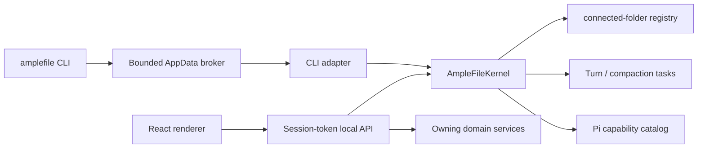

# Architecture

AmpleFile has three runtime responsibility layers and one shared in-process management plane:

1. The React renderer presents a persistent connected-folder-identity header menu plus Files, Chats, and History rail surfaces; the Skills & Extensions popup; and agent configuration in Settings.
2. The local Node host owns filesystem access, conversations, resource import, Pi sessions, and the domain services that authorize mutations.
3. Electron supplies native windows, menus, dialogs, secure storage, lifecycle, and packaging.

In the packaged app, the local Node host runs inside Electron's main process; development mode can run it as a separate local process beside Vite. Inside that host, `AmpleFileKernel` is the read-only control plane shared by the local API/renderer and desktop CLI. It resolves actor context and returns versioned Connected Folder, task, and capability snapshots. It is not another process, database, public HTTP service, or mutation authority.

The renderer never receives provider secrets or unrestricted filesystem access. Native and filesystem operations cross typed API or preload boundaries.

## Shared management plane

The desktop host creates one `AmpleFileKernel` and passes it to both `startLocalApi` and `AmpleFileCliKernelAdapter`. The packaged renderer/local API and installed CLI therefore share one live registry of agent work. Scripts such as `amplefile:drive` use the same semantics and code path but normally create their own temporary host unless they attach to an already-running development API; future adapters must be explicit about which host and kernel they observe.

An actor includes its kind and may include a current directory, Connected Folder id, or conversation id. Explicit Connected Folder id wins; otherwise the deepest registered Connected Folder root containing the actor's current directory wins. Snapshots carry a compatibility version and cover context, registered Connected Folders, running agent turns/Chat compactions, and Pi capabilities with packages, trust, provenance, and diagnostics.

The kernel observes and projects domain state; it does not own writes. Renderer mutations still pass through local API handlers, registered Connected Folder authorization, capability-mutation locks, filesystem safety, and History. Agent turns and compactions register a kernel task at acceptance and finish it in cleanup paths. Capability mutations are rejected while affected work is active.

The public `amplefile` command uses a compact adapter that omits content. Its protocol-v1 request/response files live under `~/Library/Application Support/AmpleFile/cli`; Electron's single-instance handoff lets a command contact the running app or start a headless host. The channel is bounded and same-user, but not authenticated, so it remains read-only. See [AmpleFile agent and CLI](amplefile-agent-and-cli.md) for the full snapshot, adapter, CLI, and security contracts.

## Product model and navigation

**AmpleFile** is the product. A **Connected Folder** is its unit of work: an understandable context for an activity, backed by one ordinary folder. Creating a Connected Folder creates a managed folder; turning an existing folder into a Connected Folder registers that folder in place. Neither path converts the user's files to an application-specific format.

The persistent connected-folder-header menu establishes the active root-folder entity and owns create/register/manage actions; a Connected Folder is not itself a peer navigation surface. The primary information architecture is:

- **Files** — the ordinary folder contents of the selected Connected Folder.
- **Chats** — conversations associated with the selected Connected Folder, followed by collapsed groups for every other registered Connected Folder, including zero-count groups in the current view.
- **History** — checkpoints and recoverable changes for the selected Connected Folder.
- **Skills & Extensions** — one popup dialog, opened by the rail's Add button and pinned to the Connected Folder it was opened from, with Installed/Discover views for Skills and Extensions, available personally or from a registered Connected Folder. Package provenance and lifecycle live here without becoming another rail destination.

There is no Library: the desktop surface went on 2026-09-25 and the CLI `library` family and its routes on 2026-10-10.

Provider, model, and authentication configuration for the Pi-powered agent lives under **Settings → AI Models**.

The concepts have deliberately different scopes and trust levels. Ordinary files are passive. Skills influence how the agent works and may include scripts. Extensions execute code or reach other systems and therefore require stronger, explicit trust. Combining them in one management surface does not collapse those differences: type, provenance, scope, load state, diagnostics, and package contents remain visible. Making something available does not silently activate it or add it to a chat's context.

Surface tabs are Connected Folder–bound rather than global views of the currently selected folder. Activating a tab activates its owning Connected Folder, and switching Connected Folders restores that Connected Folder's most recent tab. Browser tabs are the one exception: they belong to no Connected Folder, and each shows a page that Electron main owns in one persistent browser session, placed over the tab like an app view and driven by Workers through Electron's debugger ([built-in browser](built-in-browser.md)). All open Chat panels remain mounted while the window exists; an accepted Pi turn continues in the app-owned local API while its tab is inactive, the window is minimized, the Windows window is hidden to the system tray, or the last macOS window is closed and later recreated from the Dock. Event-stream reconnects use server turn-state snapshots and persisted transcript rehydration so renderer sleep, window recreation, or wake does not lose the result.

The AmpleFile agent popover is the one desktop surface outside the tab system: a small separate frameless window (`popover.html`, its own lean renderer entry) owned by the tray/menu-bar integration, loading through the same app protocol, session-authenticated local API, and navigation guards as the main renderer. It has its own narrow preload bridge rather than inheriting the main renderer's desktop powers. It exists so the AmpleFile agent stays reachable when no main window does, and it deliberately does not amend the Connected Folder–bound tab contract. The same session-authenticated local API also serves the AmpleFile agent's renderer-only needs-you routes (agent questions and due snoozes; deliberately excluded from the CLI act facade) and the app-composed overview digest, which no in-app surface currently renders.

Loaded Pi Extensions may contribute a validated declarative surface through a bounded `surface.json` file beside their entry point. The capability catalog carries this metadata to the renderer, which keeps the three primary rail destinations fixed, places contributed apps in a separate rail region, renders their navigator and content with host-owned components, and opens each view as a Connected Folder–bound tab. This contract carries no HTML or executable renderer code. Invalid manifests remain diagnostics on the owning capability. See [Extension surfaces](extension-surfaces.md).

Technical types, routes, and storage paths use `connected-folder`, `project`, or `resource` where those are the precise domain or Pi terms. User-facing copy should use **Connected Folder** for the working context. Pi's own “resource” terminology remains appropriate when describing Pi runtime discovery rather than ordinary files.

## Storage

Every Connected Folder is backed by an ordinary content folder. Its small portable data layer lives under `.amplefile/`: `connected-folder.json` carries a stable, versioned identity and `conversations/` carries append-only Chat logs. AmpleFile reuses a valid manifest id when a moved folder is relinked. `.amplefile/`, preserved legacy `.workspace/`, and `.pi/` are hidden from the Files surface and excluded from History capture. A Worker's grep and find also leave `.amplefile/` and `.workspace/` out at any depth, so a broad search never surfaces Chat transcripts; a deliberate read still works, and `.pi/` stays searchable because a Worker may be asked to work on this Connected Folder's own Skills & Extensions.

AmpleFile is a clean authority domain. It does not open, parse, import, migrate, mutate, wipe, or delete a legacy Workspace application profile, `.workspace/` record, registry, connection, storage namespace, receipt, or artifact. Registering the same ordinary folder creates new AmpleFile identity under `.amplefile/`; preserved legacy bytes remain inert. Pi personal resources and authentication may remain shared at the configured Pi root, while AmpleFile sessions use `sessions/amplefile/`.

Operational state remains outside the folder. Electron user data holds the Connected Folder registry, content-addressed History objects, ignore rules, provider credentials, and application preferences. Development API, non-packaged Electron, and uninstalled Windows package directories default to a distinct `AmpleFile Development` application-data root, with `AMPLEFILE_STATE_DIR` and `AMPLEFILE_DESKTOP_STATE_DIR` reserved as explicit overrides, so those development entrypoints do not touch the installed product's state. A production-signed macOS candidate is different: it uses normal AmpleFile state by default even outside `/Applications`; an explicit `AMPLEFILE_DESKTOP_STATE_DIR` override is needed for separate app data, and it does not isolate Keychain. On Windows, the installer-owned sibling uninstaller—not the updater manifest—distinguishes an NSIS installation from the same packaged bytes before installation. The separate `AMPLEFILE_CLI_STATE_DIR` exact root keeps packaged child CLI requests on the owning app's broker without granting a later desktop process access to that state. A recognized registry version newer than the current binary remains byte-for-byte untouched and routes packaged startup to updater/release recovery instead of destructive downgrade; malformed state still fails closed. The configured Pi agent directory holds Pi sessions, Pi's own trust store for other native consumers, personal capabilities, and Pi settings. Native Pi project skills, extensions, prompts, settings, and context stay separately under the Connected Folder's `.pi/` directory. AmpleFile's runtime provider authorizes the exact registered root and explicitly denies unregistered roots; it does not rewrite Pi's independent trust store. Removing a linked Connected Folder preserves its ordinary files and `.amplefile/`; deleting a managed Connected Folder removes the managed folder. Managed deletion is blocked if preserved `.workspace/` metadata exists beneath the claimed tree, so AmpleFile cannot recursively erase legacy product state. Removal first persists a machine-local intent and installs a whole–Connected Folder runtime fence, then revokes trust and clears App state before final cleanup. Interrupted intents stay hidden and untrusted for startup recovery. Managed deletion atomically claims the exact canonical directory identity under a random transaction-bound same-filesystem path, revalidates and records that claim, and recursively deletes only the claim rather than any later replacement at the registered path. Either removal is blocked while the Connected Folder is the source or target of an active release-backed App Instance, so uninstall can make the data disposition explicit first. A source Connected Folder is also blocked while its Project owns retained App data. After those obligations are gone, source removal clears that machine-local App Project, Development Instance, prepared operations, Releases, and administrative receipts, and marks unreferenced Release objects for safe reconciliation; transient cleanup failure is retried before later App mutations and at startup. Target removal cancels prepared operations aimed at that target. Both first keep what they clear, with copies of the previews' packages and the verified Release envelopes, as one Recently deleted item that the service re-verifies when it is restored (2026-10-11).

An app-state `resources/` folder left by an earlier build's Library is not read, attached to conversations, or deleted.

File change streams retain the logical Connected Folder root as the access-policy boundary but pass a `realpath`-canonical root to native `fs.watch`. On Windows this avoids Node/libuv aborts when the same folder is represented once by its long path and once by an 8.3 short path. The watcher fallback remains non-recursive where the host does not support recursive watching.

Connected Folders synchronized by Google Drive for desktop or other desktop sync tools can be turned into Connected Folders like any other local folder. Native cloud-provider mirroring is a separate feature and should use a provider-neutral adapter with stable remote IDs and explicit conflict handling.

## Connected Folder authorization

Creating or registering a Connected Folder is the single user action that authorizes AmpleFile to load executable project configuration from that exact folder. The shared runtime authority is derived from the Connected Folder registry, so the renderer, local API, kernel, CLI projection, and Pi sessions cannot drift. Removing the Connected Folder revokes AmpleFile's authorization. Registration is not code review: native Pi Extensions still run with the current user's permissions, and synchronized or source-controlled `.pi` content can change later.

## Packaging

The packaged app contains the compiled Electron/local API runtime, renderer, Pi production dependencies, neutral icons, and external CLI shims. The shims remain outside `app.asar` while Electron keeps the `RunAsNode`, Node options, and CLI inspect fuses disabled and validates embedded ASAR integrity.

Electron Builder is the canonical packager for the active Apple-silicon macOS lane. The structural lane creates an ad hoc signed `AmpleFile Local Smoke.app`, DMG, ZIP, both blockmaps, `latest-mac.yml`, and checksums, then verifies the bundle, fuses, packaged JXA CLI helper, and mounted image. The local smoke has a distinct bundle id, build channel and application-data directory, and its runtime never starts the production updater. Developer ID signing, notarization, and production-identity interactive testing are a separate release mode. There is no Windows package lane.

On Windows 11 22H2 or newer, Electron may use Mica when reduced transparency is not requested. The preload reports the selected material before React renders so root chrome can become transparent without a first-paint flash; content surfaces remain opaque. Older Windows builds and reduced-transparency sessions use theme-matched solid backgrounds.

macOS uses a hidden-inset native title bar with traffic lights and native application/File/Edit/View/Window/Help menus. Sidebar vibrancy is limited to structural chrome when reduced transparency is off; content surfaces remain opaque and use a theme-matched solid fallback. Packaged child processes inherit `AmpleFile.app/Contents/bin` so the Mac protocol-v1 CLI can address the exact app without changing a shell profile.

`desktop:prepare` runs the production renderer and Electron compile and native Pi preflight. The package does not contain a bundled document library, private Skill catalog, provider key, or signing material. See [macOS build and release lane](macos-build.md) for verification and publishing.
